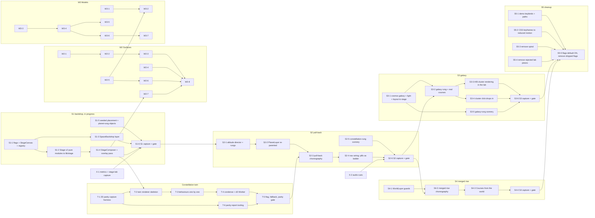

# Layer Transitions, Surfaces and Models Implementation Plan

> **For agentic workers:** REQUIRED SUB-SKILL: Use superpowers:subagent-driven-development (recommended) or superpowers:executing-plans to implement this plan task-by-task. Steps use checkbox (`- [ ]`) syntax for tracking.

**Revised 2026-10-11.** Philote reviewed the integration and the model changed: the header keeps its two pills, the constellation stays the real graph and migrates its renderer into the stage as a WebGL twin, the corner spiral goes away in favour of the lab's space backdrop, and the work ships as five product slices behind flags. W1 is re-cut below; W2 (surfaces) and W3 (models) are unchanged in substance. The 2026-10-10 decisions stay in force and are kept in the Decisions section.

**Goal:** Make planet, constellation and galaxy one place at three altitudes inside one persistent stage canvas: the real constellation condenses into its bead as the camera pulls back, the galaxy holds every course on its arms, the world rises through its clouds into the sky, and every rung has its own seeded scenery; plus surfaces that read at 2 px and a model pipeline for boats, props and walking buddies.

**Architecture:** `ProductShell` mounts one `StageCanvas` (S1, in progress). Layers are `THREE.Scene`s rendered through one `StageComposer` (the lab's Stage v2 composer: pixel pass, streaks, flash) plus a full-resolution overlay pass for the constellation. A spring on an altitude value `L` (lab `spring.ts` / `altitude.ts`) drives the camera between rungs; visibility is an altitude ramp (`fades.ts`), never a mount. The constellation twin renders `forceLayout`'s positions in WebGL with DOM labels, pixel-diffed against the 2D canvas before it replaces it. One seeded placement generator per rung scatters scenery objects from the cosmos lab. Surfaces are shader entry points on the existing toon materials; models go source → Blender → `gltf-transform optimize` → QA → `useGLTF`.

**Tech Stack:** Next.js 16.3.5 App Router, React 19.2.8, three 0.186 (`three/addons` `EffectComposer`, `RenderPixelatedPass`, `ShaderPass`, `OutputPass`, `FullScreenQuad`), `@react-three/fiber` 9.7 (`createPortal`), `@react-three/drei` 10.7, d3-force (main thread first, Worker later), Vitest 4, Playwright (from `prototypes/marker-lab`), `pixelmatch` + `pngjs` for parity diffs, Blender 5.2 LTS headless, `@gltf-transform/cli`, Tripo / Meshy / Poly Pizza / PixelLab HTTP APIs.

**Spec:** `docs/superpowers/specs/2026-10-10-layer-transitions-surfaces-models-design.md` (revised 2026-10-11; points at the canvases and the lab for beat tables, recipes and measurements).

## Global Constraints

- Stack pins: `three` 0.186, `@react-three/fiber` 9.7, `@react-three/drei` 10.7, WebGL renderer. No R3F 10, drei 11, WebGPU or TSL.
- One persistent `StageCanvas` in `ProductShell` with visibility-gated layers and one composer (Philote, 2026-10-10). No second product canvas.
- Header: the two pills **Courses** and **Information** stay. No altitude ladder in the header; the `/lab/shell` LadderNav prototype is rejected for the product. Its indicator math (`components/lab/shell/ladder-indicator.ts`) may be reused internally (rung readout for the spring), never as UI.
- Information is a ladder keyed to the active course: planet → that class's constellation; constellation → the galaxy; galaxy → nothing. Courses: constellation → planet locked on that landmark; galaxy → planet on the most recent or default course; world → planet. In the galaxy, clicking a course's cluster drops into that course's constellation. Cycling courses at galaxy level is deferred until after the migration.
- The constellation stays the real one: same data (`useStore().graph`, `buildGraphModel`), same `forceLayout` d3 settle, same `buildSpaceClusters` clustering, `spacePalette` colours, `constellationLabels` budgets, `pickWeakSequences`, files dock and every click behaviour. Only the renderer migrates. The twin renders at full resolution in its own pass composited over the pixelated stage and is never pixelated; labels are DOM text. The 2D canvas stays as the fallback behind the flag and under reduced motion until Philote signs off.
- Pixel look: `RenderPixelatedPass` at a fixed 2 px cell at rest for the stage layers; integer multiples only during a hop; HTML text never enters the pixel pass; the constellation pass is excluded from it.
- Hardware bar: Philote's laptop, vsync-locked. A hop passes when the lab's `PerfOverlay` statistics report 0 dropped frames and 0 programs compiled after the hop starts. No mobile requirement now.
- Space objects live on every rung and carry no meaning yet. Placement is seeded per student (`seed = fnv1a(studentId)`), one placement generator per rung; no two students share a sky.
- Preview gate (Philote, 2026-10-10: "let me see things first before you mess with our app"): every user-visible change ships first as a lab route (`/lab/**`) or `/design` route, or behind a flag whose default is OFF; a capture (sheet or recording) is shown to Philote and signed off before the flag defaults ON or a product file changes default behaviour. Per-slice gates are in Milestones and Rollout.
- Generator credits: no new spend (Philote, 2026-10-10). Scripts read the Tripo / Meshy / PixelLab balance via `tools/asset-pipeline/credits.mjs`, fail closed, keep `--confirm`, and fall back to hand-built geometry.
- VFX are hand-rolled `InstancedMesh` / `Points` only. No `r3f-vfx`, no `three.quarks`.
- Source GLBs carry no extensions; served copies under `optimized/` may carry `EXT_meshopt_compression` only. Every new GLB passes `python3 tools/qa/check_glb.py` with its kind before `frontend/` references it.
- Laning constraints from 2026-10-10 are lifted: no one else is editing `ice-town/edge/**`, `components/audio/**`, `product.css` or `app/lab/**`. Lab files may be moved and deleted per the File map. `/lab/**` and `/design/**` remain the preview surfaces.
- S1 is in progress right now by an implementation agent in `frontend/components/stage/**` and `frontend/components/shell/ProductShell.tsx` behind `stage-backdrop`. S1 tasks below are the contract that agent builds against; other lanes consume its exports and do not duplicate them.
- Tests: `*.test.ts` next to the source (Vitest, `environment: node`); `lib/audio/*.test.mts` under `node --test`; shader code is tested through pure TS helpers. Do not create commits unless the user explicitly requests them; end each task with a review checkpoint.
- Reduced motion is a complete path: no camera travel; since 2026-10-13 it is the hop runtime's 200 ms crossfade of the rest poses (`reducedHopAt`) with the twin rendered static, not CSS keyframes and not the 2D constellation (both deleted).

---

## Decisions (Philote, 2026-10-10)

1. **Stage architecture: one persistent `StageCanvas` with visibility-gated layers.** Plan B (two stacked canvases) is rejected.
2. **Constellation: keep `KnowledgeCanvas` as Canvas2D now; only sky objects move to 3D.** Superseded in part on 2026-10-11 (below): the renderer migrates into the stage as a WebGL twin, the 2D canvas stays as the flagged fallback.
3. **VFX: hand-rolled `InstancedMesh` / `Points` only.** No `r3f-vfx`, no `three.quarks`.
4. **Generator credits: no new spend.** "Just spend what I have, if I don't have it then hand build it." Balance check, fail closed, `--confirm`, hand-built fallbacks.
5. **Meshopt: yes.** `optimized/` served copies, source GLBs stay plain.
6. **Preview gate.** "do what you think but always remember to let me see things first before you mess with our app." Flags default OFF; captures before any flip.

## Decisions (Philote, 2026-10-11)

**Navigation.**
- The two header pills stay: Courses and Information. No altitude ladder in the header. The `/lab/shell` LadderNav prototype is rejected for the product; its indicator math may be reused internally only.
- Information is a ladder keyed to the active course. On the planet (settled on a class, which it auto-locks to) Information → that class's constellation; in a constellation → the galaxy; in the galaxy → does nothing.
- In the galaxy, clicking any course's cluster drops into that course's constellation (information graph). Cycling between courses at galaxy level (like the planet's settle) is deferred until after the migration.
- Courses: from a constellation → the planet locked on that landmark; from the galaxy → the planet on the most recent or default course.
- From inside a world (biome), Information rises through the clouds, past the planet and up into the constellation as one motion (the lab's merged hop); per-world masks replace the cloud layer later.

**Visuals.**
- Planet → constellation is the lab pull-back (Stage v2 spring / altitude / streaks), with the planet shrinking to a centred point rather than becoming a star object; the exact end state is settled in the lab.
- The constellation stays the real one: same data, d3 layout, clustering, colours, label rules, weak-area sequences, files and click behaviours. Only the rendering migrates from Canvas2D (`components/graph/KnowledgeCanvas.tsx` + `components/constellation/**`) to WebGL inside the persistent stage: "WebGL twin" first, finishing into a full port with d3 in a Worker, so the graph can condense continuously into its bead.
- Parity gate: capture the current 2D constellation in every state (zoomed out with cluster names, zoomed in, hover, selected node, weak areas on, files, light and dark) and pixel-diff the twin against them. The graph renders full-resolution in its own pass composited over the pixelated stage (never pixelated); DOM text for labels; the 2D canvas stays as fallback behind a flag and under reduced motion until Philote signs off.
- The lab's `Cluster2` / `cluster-spec` are discarded; only the sprite shader may be reused for node glyphs.
- Galaxy-level clusters: build both "every course as its real tiny graph" and "real graph for the current course, beads for the rest" and A/B them in the lab.
- The corner spiral (`GeneratedPixelSpiral` / `SkySpiral`) is temporary and goes away. The new space (lab star field + far galaxy + parallax depths, dark and light) is the backdrop at every rung; the full polished galaxy (`cosmos/galaxy` + light module + layout generator with real courses) is the top.
- Space objects live on every rung (planet: moons, station, passing comet; constellation: nebula, black hole and so on; galaxy: scenery between clusters), seeded per student so no two students share a sky. Scenery first, meanings later. One seeded placement generator per rung.

**Process.**
- Five product slices, each behind a flag defaulting OFF with a captured preview before it flips: S1 new space backdrop replacing the corner spiral on `/earth` and `/knowledge` (no motion change yet), implemented as the first layer of the persistent `StageCanvas` mounted in `ProductShell`; S2 planet → constellation pull-back with the WebGL constellation twin; S3 constellation → galaxy with real courses on the arms (plus the A/B); S4 world → constellation merged rise; S5 cleanup: remove demo keybinds (1/2/3/F/P) and demo-only paths ("pivoting to true product"), remove the CSS hop keyframes except under reduced motion, remove `GeneratedPixelSpiral` / `SkySpiral`.
- Hardware bar: Philote's laptop, vsync-locked; no mobile requirement now. Nothing in the galaxy objects carries meaning yet.

## Decisions (Philote, 2026-10-13)

**Gate 1 (S2-2): the planet rendered inside the persistent stage canvas is approved.** "Just go with what you developed, just don't forget that it's pixelated." The stage-hosted globe (`PlanetLayer` through the composer's PIXEL path, 2 CSS px per cell at rest, 3 on the hop ramp) is the only globe path; the globe's own `<Canvas>` + `RenderPixelatedPass` and the `planet` flag were deleted the same day (see "Eliminated"). The pixelation is now a guarantee, not a look: `composer-model.test.ts` pins the grain per dpr and `tools/qa/stage/verify.mjs` (`npm run qa:stage`) measures 2x2 / 4x4 device-px block constancy on default `/earth` at dpr 1 / 2 (>= 99 %), diffs the default page against the approved `?stage=planet` capture, checks the flag params are inert, and drives wheel / settle / pick / flag / Land dive / rise headless.

**Gate 2 (T-5): the WebGL constellation twin is approved** ("phenomenal"). The twin is the one constellation renderer; the Canvas2D drawing path, hit testing and hidden canvas in `KnowledgeCanvas` were deleted the same day (the file is now the layout owner: the d3 `Layout`, the bridge publish, the `CanvasHandle` announcements and the QA `LayoutControl`), with the `twin` flag. The parity captures become the twin's own golden snapshots (`tools/qa/out/constellation-twin`, 28 states; `npm run qa:constellation` diffs a fresh run against them, 0.00 % on 2026-10-13). Under reduced motion the twin renders static (no tweens, pops or pulses) and crossfades with the hop.

**Gate 3 (S3-6): the galaxy rung with version C blobs and the inka-style flags is approved** ("I love it") **with one change: the flag is sticky** ("make it so that the flag stays on the one I most recently hovered over"). At rest the current course's flag is up; hovering a blob moves the flag there and it stays after the pointer leaves, until another blob is hovered or the rung is left, which resets it to the current course for the next visit (`stickyFlagNext` / `shownFlags` in `galaxy-rung-model.ts`, pinned in `galaxy-rung.test.ts`). The anti-radial leader, fallback and collision rules, the enter / exit motion and the reduced-motion behaviour are unchanged. The `galaxy` flag went with it.

**Gate 4 (S2-6 / S4-4): the hops are approved** ("love it, keep your developments"), then **"now consolidate everything as we intended"**: the `hop` and `world` flags went, the stage flag system with them (`lib/stage/flags.ts`, `useStageFlags`, `StageSlots` flags, the `StageCanvas` props; `?stage=...` is an inert unknown parameter, `lib/stage/params.ts` keeps `?perf=1` and `?rung=`), the CSS route hops (`lib/stage-motion.ts`, `shell-nav`'s leave phases, every hop keyframe) and the lab's Stage v2 scene (the product carries it). `prefers-reduced-motion` is the only behaviour switch: the director tweens `L` over 200 ms and the hop runtime reads it as a crossfade of the two rest poses (`reducedHopAt`), no camera travel, no clouds, no streaks, no grain ramp.

**The cloud dive** ("I love the little splash thing, the cloud-deck pass-through on the rise, but I would love for you to use it going from the planet going into the world and coming out instead of only coming out"): planet -> world is now one director request (`onLand`, from a landmark click or the flag's Land button) running the rise's own curves backwards (`worldRiseAt` is a function of `L` alone): the land route is pushed at the press (the land mounts under the deck), the planet chrome is ghosted and fades by L 0.8, the planet camera drops from the seat to over the landmark (`PlanetPullback`'s approach, reversed), the deck closes (whole from 0.68 to 0.46), the globe pass goes out and the land pass comes in under it, the land camera breaks out beneath the clouds down the dive path (`risePose` read down) onto the island, and the land chrome fades in from L 0.3. The land must be ready: hovering or settling on a landmark prefetches its code chunk and world payload (`lib/world/land-prefetch.ts`); the land's scene graph mounts only once the deck is whole and its programs compile in parallel (`renderer.compileAsync`); if it is still not ready at the top of the full deck (L 0.68) the director parks inside the clouds (`CLOUD_HOLD`, `StageDirector.hold`: deck whole, streaks none, the deck's own drift the only motion) until the world layer reports ready, never showing a half-loaded land. Courses / Escape / "The planet" from the land is the existing rise. The CSS `course-globe-dive` / `course-globe-rise` / `biome-land-arrive` path and `DiveCamera` are gone. Developed biomes other than ice-town keep their own canvas (`OWN_CANVAS_BIOMES`, open decision 8): they stand in as the world rung and a ready world layer toward the director, dissolve in on the view beat, and the stage pauses behind their opaque canvas while the director rests.

---

## Milestones

| Milestone | Demoable outcome | Preview gate (what Philote sees before the flag flips) | Tasks | Size |
|---|---|---|---|---|
| **S1** New space backdrop (in progress) | `/earth?stage=backdrop` and `/knowledge?stage=backdrop`: the lab star field, far galaxy and parallax depths replace the corner spiral and the 2D star canvas, dark and light; no motion change; planet-rung scenery (moons, station, a passing comet) seeded per student | `/lab/space` backdrop pane beside the current sky; `/earth` and `/knowledge` with `?stage=backdrop` next to flag-off; `tools/stage-lab/capture.mjs --backdrop` sheet (both routes × both themes × two seeds); `PerfOverlay` stats at rest | S1-1 … S1-6 | M |
| **T** Constellation twin (parity, no product change) | `/knowledge?stage=twin`: the real graph rendered in WebGL inside the stage, DOM labels, every behaviour of the 2D canvas; pixel-diff against the 2D captures under the agreed threshold | The parity sheet (`tools/qa/out/constellation-parity/report.html`: 2D vs twin vs diff for every state, light and dark) and a recording of hover / select / weak / files on the twin | T-1 … T-6 | L |
| **S2** Planet → constellation pull-back | `/earth?stage=backdrop,pullback,twin`: Information from the planet pulls back on the lab spring; the planet shrinks to a centred point; the real constellation expands from its bead; Courses returns to the planet locked on the landmark | `/lab/space` end-state study (planet point); `tools/stage-lab/capture.mjs --hop pullback` frame sheet at fixed `L`; a vsync recording both directions; `PerfOverlay` 0 dropped frames | S2-1 … S2-6 | L |
| **S3** Constellation → galaxy with real courses | `/knowledge?stage=galaxy`: Information from a constellation rises into the polished galaxy with the student's courses on the arms; clicking a cluster drops into that course's constellation; the A/B of cluster rendering decided | `/lab/space?ab=graphs` vs `?ab=beads` side by side with the real course list; galaxy-rung scenery sheet (two seeds, both themes); recording of constellation → galaxy → click → constellation | S3-1 … S3-6 | L |
| **S4** World → constellation merged rise | `/earth?land=8.223&stage=merged`: Information from inside the biome rises through the clouds, past the planet, into the constellation as one motion; Courses from the world rises to the planet | `tools/stage-lab/capture.mjs --hop merged` sheet; recording from the harbour station; `PerfOverlay` stats | S4-1 … S4-4 | M |
| **S5** Cleanup | Demo keybinds and demo-only paths gone; CSS hop keyframes only under reduced motion; `GeneratedPixelSpiral` / `SkySpiral` deleted; shipped-slice flags removed | Full run-through recording of planet → constellation → galaxy → cluster click → Courses → world → Information, flags removed; `npm test`, `typecheck`, `build` green | S5-1 … S5-5 | M |
| **M-W2** Surfaces pass on ice-town + globe | Capture sheet at 2 px: tinted ramp, dithered fog, foam ring, texel-stable triplanar ground, bevel highlights, shallows band, terminator dither | `/design/stage?layer=world&stage=fog,triplanar,water` and `?layer=planet`; `surfaces-*.png` sheets; `surfaces-budget.json`; 10 s pan recording | W2-1 … W2-8 | L |
| **M-W3** Ship + prop pipeline | Lofted container ship at 20 and 240 px; `tools/asset-pipeline`; QA kinds; one Poly Pizza prop through the Blender loop; one buddy walking (Tripo if the balance covers it, else hand-built) | `/design/ships` sheet; Blender `look` sheets; `assets/QA.md`; walking-buddy recording | W3-1 … W3-7 | M |

Nothing in a row defaults ON, and no product file changes default behaviour, until that row's preview gate has been shown to Philote and the sign-off recorded in the Rollout table.

## Dependency graph



## Parallel lanes

| Lane | Tasks | Start now? | Files it owns |
|---|---|---|---|
| **S1** backdrop (implementation agent, in progress) | S1-1 … S1-6 | running | `frontend/components/stage/**`, `frontend/lib/stage/**`, `frontend/components/shell/ProductShell.tsx`, `frontend/components/stage/stage.css` |
| **T** constellation twin | T-1 … T-6 | yes (T-1 and T-6 need nothing from S1; T-2 waits for the overlay pass in S1-4) | `tools/qa/constellation-parity/**`, `frontend/components/stage/layers/constellation/**`, `frontend/lib/graph/**`, `frontend/components/graph/KnowledgeWorkspace.tsx` (dev hooks only until T-5) |
| **S2** pull-back | S2-1 … S2-6 | after S1-6 and T-5 | `frontend/components/stage/StageDirector.tsx`, `frontend/lib/stage/rungs.ts`, `frontend/components/stage/layers/PlanetLayer.tsx`, `frontend/components/world/globe/*`, `frontend/components/shell/ProductHeader.tsx`, `shell-nav.tsx`, `frontend/components/earth/EarthShell.tsx` |
| **S3** galaxy | S3-1, S3-5 now; S3-2 … S3-6 after S2-6 | partly | `frontend/components/stage/layers/galaxy/**`, `frontend/lib/light/**`, `frontend/lib/galaxy/**`, `frontend/components/lab/space/**` (A/B lab route) |
| **S4** merged rise | S4-1 now; S4-2 … S4-4 after S2-6 | partly | `frontend/components/stage/layers/WorldLayer.tsx`, `frontend/components/world/biomes/ice-town/Mount.tsx`, `camera/CameraRig.tsx`, `frontend/components/world/WorldPage.tsx` |
| **S5** cleanup | after S3-6 and S4-4 | no | product CSS, `components/shell/GeneratedPixelSpiral.tsx`, `SkySpiral.tsx`, `components/earth/DemoTheater.tsx`, `lib/world/demo-theater.ts`, lab leftovers |
| **X** cross-cutting | X-1 now, X-2 now | yes | `frontend/lib/stage/metrics.ts`, `tools/stage-lab/**`, `tools/sound-factory/presets.json`, `frontend/lib/audio/catalog.ts`, `events.ts` |
| **W2** surfaces | W2-1, W2-2, W2-5, W2-6, W2-7 now; W2-3, W2-4 any time (laning lifted) | yes | `frontend/components/world/biomes/shared/**`, globe materials, `ice-town/render/materials.tsx`, `scene/Terrain.tsx`, `frontend/lib/toon.ts` |
| **W3** models | W3-1 … W3-7 | yes | `frontend/lib/world/container-ship.ts`, `hull-loft.ts`, `GlobeShips.tsx`, `tools/asset-pipeline/**`, `tools/qa/**`, `tools/creature-factory/**`, `tools/texture-factory/**`, `assets/props/**` |

Critical path: S1-1 → S1-4 → T-2 → T-3 → T-4 → T-5 → S2-3 → S2-4 → S2-6 → S3-2 → S3-6 → S5-5. S4 joins after S2-6. T-1 (the parity capture harness) starts today and is the gate everything in the constellation lane is measured against.

## File map: lab → product

Nothing is rewritten twice. "Move" means `git mv` plus import fixes and the test file moving with it; "discard" means delete in S5 after the replacement is signed off.

| Lab source | Product destination | Note |
|---|---|---|
| `components/lab/space/stage2/spring.ts` | `lib/stage/spring.ts` | Pure; `stage2.test.ts` splits into `spring.test.ts` |
| `components/lab/space/stage2/altitude.ts` | `lib/stage/altitude.ts` | Pure; the `L` axis, scales between layers, `CameraContext` |
| `components/lab/space/stage2/fades.ts` | `lib/stage/fades.ts` | `LayerFader`; visibility as an altitude ramp |
| `components/lab/space/stage2/render/PixelComposer.tsx` (`Stage2Frame`, `createStage2Frame`, `PrewarmInfo`) | `components/stage/StageComposer.tsx` + `lib/stage/frame.ts` | Gains the full-res overlay pass for the constellation twin |
| `components/lab/space/stage2/PerfOverlay.tsx` (`PerfProbe`, `computeStats`, `droppedFrames`, `estimateRefreshMs`) | `lib/stage/perf.ts` (pure stats) + `components/stage/PerfOverlay.tsx` (dev only) | The hardware bar is measured with these |
| `components/lab/space/stage2/Stage2Scene.tsx` (`Stage2Request`, `Stage2Api`, `Stage2Readout`) | `components/stage/StageDirector.tsx` (`StageRequest`, `StageApi`, `StageReadout`) | Mocks replaced by the real layers |
| `components/lab/space/stage2/Planet2.tsx` (`Planet2Control`) | `components/stage/layers/PlanetLayer.tsx` | The control record drives the real globe (marker scale, features, tint by altitude) |
| `components/lab/space/stage2/World2.tsx` (`World2Control`) | `components/stage/layers/WorldLayer.tsx` | Props / clouds / ground fades drive the real biome |
| `components/lab/space/stage2/Cluster2.tsx`, `components/lab/space/stage/cluster-spec.ts`, `cluster.tsx`, `beads.tsx` | discarded | Replaced by the constellation twin |
| `components/lab/space/stage/sprite-shaders.ts` (`CLUSTER_STAR_VERT/FRAG`, `BEAD_VERT/FRAG`, `RING_FRAG`, `LINE_VERT/FRAG`), `sprite-materials.ts` | `components/stage/layers/constellation/glyph-shaders.ts`, `glyph-materials.ts` | Only the sprite shader survives, as the node glyph; bead/ring used for far-course beads in S3 |
| `components/lab/space/stage/director.ts` (`GALACTIC`, `CHAINED`, `MERGED`, `logDistanceAt`), `ladder.ts` (`layerCamera`, `curveL`, `scheduleHit`, `GATE`), `easing.ts` | `lib/stage/choreography.ts`, `lib/stage/easing.ts` | Beat constants and the `L` curves; the hop tables from the 2026-10-10 plan are superseded by these measured ones |
| `components/lab/space/render/LabComposer.tsx`, `curtain-pass.ts`, `layer-pixel-pass.ts`, `post-shader.ts` | `components/stage/passes/layer-pixel-pass.ts`, `post-shader.ts`; `curtain-pass.ts` kept behind `stage-curtain` only | Stage v1 composer pieces the v2 composer still uses |
| `components/lab/space/galaxy/StarField.tsx` (`StarShell`, `STAR_LAYERS`) | `components/stage/layers/backdrop/StarShell.tsx` | S1 backdrop; replaces `shell/SpaceField.tsx`'s 2D stars |
| `components/lab/cosmos/gravity/field/StarField.tsx`, `star-geometry.ts`, `star-shaders.ts` | `components/stage/layers/backdrop/StarField.tsx`, `lib/space/star-geometry.ts`, `star-shaders.ts` | Parallax depths for the backdrop |
| `components/lab/cosmos/galaxy/**` (`galaxy-spec.ts`, `galaxy-points.ts`, `galaxy-shaders.ts`, `Galaxy.tsx`, `palettes.ts`, `galaxy.test.ts`) + `PATCH-for-lab-space-galaxy.diff` | `components/stage/layers/galaxy/**` | S1 uses it far and faded as the backdrop's galaxy; S3 uses it full as the top rung |
| `components/lab/cosmos/shared/light/glow.glsl.ts`, `light.test.ts`, `README.md` | `lib/light/glow.glsl.ts`, `light.test.ts`, `README.md` | Shared by galaxy, objects, gravity |
| `components/lab/cosmos/layout/galaxy-layout.ts`, `galaxy-layout.test.ts`, `map-points.ts`, `MapScene.tsx` (`hoverables`, `sceneBudget`) | `lib/galaxy/layout.ts`, `layout.test.ts`, `components/stage/layers/galaxy/CourseBeads.tsx` | `LayoutCourse[]` comes from `useIdentity().courses` + overview stats; `fake-courses.ts` stays lab-only |
| `components/lab/cosmos/objects/*.tsx` (AsteroidRing, BinaryStar, Comet, DarkNebula, EmissionNebula, GasGiant, LensedSmudges, PlanetaryNebula, ProtoDisc, Pulsar, RoguePlanet, Satellites, StarCluster, SupernovaRemnant), `lib/{orbit,points,quad,rng,types,uniforms,light}.ts` | `components/stage/objects/*.tsx`, `lib/space/objects/*.ts` | Each keeps its typed props and budget line; `exhibits.ts`, `layout.ts`, `ObjectsGallery.tsx`, `ExplainOverlay.tsx` stay lab-only |
| `components/lab/cosmos/gravity/blackhole/**`, `whitehole/**`, `wormhole/**`, `render/lens-pass.ts` (`GravityLensPass`, `SkyPixelPass`), `lib/{clock,easing,exhibit,frame,rng,uniforms}.ts` | `components/stage/objects/gravity/**`, `components/stage/passes/lens-pass.ts`, `lib/space/gravity/*.ts` | Scenery on the constellation and galaxy rungs; no meaning yet |
| `components/lab/cosmos/objects/render/StarBackdrop.tsx`, `CosmosComposer.tsx`, `gravity/render/GravityComposer.tsx`, `layout/MapComposer.tsx` | discarded after S3 | Their passes fold into `StageComposer` |
| `components/lab/shell/ladder-indicator.ts` (`rungAt`, `stepRung`, `RUNG_L`) | `lib/stage/rungs.ts` (internal) | Rung readout for the spring; never rendered as a ladder |
| `components/lab/shell/ShellHeader.tsx`, `ShellLab.tsx`, `InfoPanel.tsx`, `shell-audio.ts`, `shell-theme.ts`, `shell-lab.css`, `app/lab/shell/page.tsx` | rejected; deleted in S5-4 | `shell-theme.ts` duplicates `lib/space-theme.ts`; nothing to keep |
| `components/lab/space/SpaceLab.tsx`, `scenes.tsx`, `app/lab/space/page.tsx` | deleted 2026-10-13 (gate 4) | The product carries every beat; `/lab/cosmos/*` are the surviving benches |
| `components/lab/gallery/**`, `app/lab/page.tsx` | kept | The lab index; `lab-pages.ts` cards updated as pieces move |
| `components/shell/GeneratedPixelSpiral.tsx`, `SkySpiral.tsx`, `generated-pixel-spiral.css`, `SpaceField.tsx`, `lib/spiral-galaxy.ts` (runtime use) | deleted in S5-3 (2026-10-13) | `lib/spiral-galaxy.ts` + `scripts/export-spiral-svg.mts` kept for the static SVG under `public/assets/space` (open decision 15); `lib/space-field.ts` keeps only the edge helpers |
| `components/graph/KnowledgeCanvas.tsx`, `components/constellation/**` | drawing path deleted 2026-10-13 (gate 2); `KnowledgeCanvas` is the layout owner, `components/constellation/**` the page chrome | Renderer: `components/stage/layers/constellation/**` |

---

# W1 — Layer transitions (five slices + the constellation twin)

## S1 — New space backdrop (in progress)

### Task S1-1: Flags, stage registry and `StageCanvas` in `ProductShell`

**Status:** in progress by the implementation agent. This task records the contract; if the agent's names differ, update this table, not the other lanes.

**Goal:** One `<Canvas>` for the product, mounted once by `ProductShell` behind the page, with portal scenes that layers fill through a registry. Flag off → nothing changes.

**Files:**
- Create: `frontend/lib/stage/flags.ts`, `flags.test.ts`
- Create: `frontend/lib/stage/registry.ts`, `registry.test.ts`
- Create: `frontend/components/stage/StageProvider.tsx`, `StageCanvas.tsx`, `useStageSlot.ts`, `stage.css`
- Modify: `frontend/components/shell/ProductShell.tsx` (wrap in `StageProvider`, render `StageCanvas` after `SpaceField`, `data-stage` on `.sg-shell`)

**Interfaces:**

```ts
export type StageFlag =
  | "stage-backdrop" | "stage-twin" | "stage-pullback" | "stage-galaxy" | "stage-merged"
  | "stage-objects" | "stage-curtain" | "surf-dither-fog" | "surf-triplanar" | "surf-water";
export const STAGE_FLAG_STORAGE_KEY = "studygotchi:stage-flags";
export function parseStageFlags(sources: { env?: string | null; stored?: string | null; search?: string | null }): Set<StageFlag>; // `?stage=backdrop,twin` short names
export function closeStageFlags(flags: Set<StageFlag>): Set<StageFlag>; // pullback ⇒ backdrop+twin; galaxy ⇒ pullback; merged ⇒ pullback
export function useStageFlags(): ReadonlySet<StageFlag>;

export type LayerId = "backdrop" | "planet" | "world" | "constellation" | "galaxy" | "objects";
export interface StageRegistry { setSlot(layer: LayerId, node: ReactNode | null): void; getSlot(layer: LayerId): ReactNode | null; subscribe(fn: () => void): () => void; setReady(layer: LayerId, ready: boolean): void; whenReady(layer: LayerId): Promise<void> }
export interface StageContextValue { flags: ReadonlySet<StageFlag>; enabled: boolean /* any stage-* flag */; registry: StageRegistry; scenes: Record<LayerId, THREE.Scene>; hostRef: RefObject<HTMLDivElement | null>; director: StageApi | null }
export function useStageSlot(layer: LayerId, node: ReactNode, deps: unknown[]): boolean;
```

- [ ] **Step 1: Tests (RED)** — `parseStageFlags({ search: "?stage=pullback" })` closes to `backdrop`, `twin`, `pullback`; unknown names ignored; registry stores one node per layer, notifies, `whenReady` resolves on `setReady`.
- [ ] **Step 2: Implement** — `StageCanvas`: `dpr [1, 1.5]`, `frameloop` demand when hidden, `gl={{ antialias: false, alpha: true, powerPreference: "high-performance" }}`, `PerformanceMonitor`, `createPortal(<Suspense>{slot}</Suspense>, scenes[id])` per layer via `useSyncExternalStore` with a versioned snapshot. `stage.css`: `.sg-stage { position: absolute; inset: 0; z-index: 0; pointer-events: none } .sg-stage canvas { pointer-events: auto }`; `.sg-shell[data-stage~="backdrop"] .sg-field, .sg-shell[data-stage~="backdrop"] .sg-sky-spiral { display: none }`.
- [ ] **Step 3: Verify** — `npm run test:unit -- lib/stage && npm run typecheck`; `/earth` unchanged with flags off; `/earth?stage=backdrop` mounts one extra WebGL context (the stage) behind the page.
- [ ] **Step 4: Review checkpoint** — `ProductShell` still never remounts across routes; `SpaceField` untouched except the CSS hide.

**Size:** M

---

### Task S1-2: Stage v2 pure modules move to `lib/stage`

**Goal:** The measured spring, altitude axis, fades and perf statistics become product modules with their tests, untouched in behaviour.

**Files:**
- Move: `frontend/components/lab/space/stage2/spring.ts` → `frontend/lib/stage/spring.ts`; `altitude.ts` → `lib/stage/altitude.ts`; `fades.ts` → `lib/stage/fades.ts`; `stage2.test.ts` → split into `lib/stage/spring.test.ts`, `altitude.test.ts`, `fades.test.ts`
- Create: `frontend/lib/stage/perf.ts` (pure parts of `PerfOverlay.tsx`: `PerfSample`, `PerfStats`, `computeStats`, `droppedFrames`, `percentile`, `estimateRefreshMs`), `perf.test.ts`
- Modify: `frontend/components/lab/space/stage2/Stage2Scene.tsx`, `PerfOverlay.tsx`, `Planet2.tsx`, `World2.tsx`, `Cluster2.tsx` (import from `@/lib/stage/*`; the lab keeps running)

**Interfaces:** unchanged exports: `SpringParams`, `SpringState`, `L_MIN`, `L_MAX`, `STOPS`, `DEFAULT_SPRING`, `createSpring`, `stepSpring`, `atRest`, `nearestStop`, `clampL`; `DIVE_ALTITUDE`, `WORLD_SCALE`, `CLUSTER_SCALE`, `GALAXY_SCALE`, `CameraContext`, `worldToPlanet`; `LayerFader`.

- [ ] **Step 1: Move with `git mv`, fix imports, split the test file** so every existing assertion still runs under its new name.
- [ ] **Step 2: `perf.test.ts`** — `droppedFrames([16.7, 16.7, 33.4], 16.7)` is 1; `estimateRefreshMs` of a 60 Hz sample is within 0.5 ms of 16.67; `computeStats` reports p95.
- [ ] **Step 3: Verify** — `npm run test:unit -- lib/stage components/lab/space && npm run typecheck`; `/lab/space` still runs with 0 dropped frames.

**Size:** S

---

### Task S1-3: `SpaceBackdrop` layer — star field, far galaxy, parallax depths, dark and light

**Goal:** The lab sky becomes the backdrop at every rung: the gravity lab's parallax star field, the space lab's `StarShell` bands, and the cosmos galaxy far and faded, seeded per student, themed from `data-space-theme`.

**Files:**
- Move: `frontend/components/lab/space/galaxy/StarField.tsx` → `frontend/components/stage/layers/backdrop/StarShell.tsx`; `frontend/components/lab/cosmos/gravity/field/{StarField.tsx,star-geometry.ts,star-shaders.ts}` → `frontend/components/stage/layers/backdrop/StarField.tsx`, `frontend/lib/space/star-geometry.ts`, `star-shaders.ts`
- Move: `frontend/components/lab/cosmos/galaxy/**` → `frontend/components/stage/layers/galaxy/**` (apply `PATCH-for-lab-space-galaxy.diff` first, then delete the patch); `frontend/components/lab/cosmos/shared/light/**` → `frontend/lib/light/**`
- Create: `frontend/components/stage/layers/backdrop/SpaceBackdrop.tsx`, `frontend/lib/space/seed.ts`, `seed.test.ts`
- Modify: `frontend/components/earth/EarthShell.tsx`, `frontend/components/constellation/ConstellationPage.tsx` (register the backdrop slot when `stage-backdrop` is on; no other change)

**Interfaces:**

```ts
export function studentSeed(studentId: string | null, salt: string): number; // fnv1a; null → a fixed guest seed
export interface SpaceBackdropProps { seed: number; theme: "light" | "dark"; reducedMotion: boolean; farGalaxy: boolean /* false on the galaxy rung */ }
export function SpaceBackdrop(props: SpaceBackdropProps): JSX.Element; // StarField (3 parallax depths) + StarShell band + Galaxy at radius 0.12 of the frame, fade 0.5, features without "life"
```

- [ ] **Step 1: Test (RED)** — `studentSeed("a", "sky") !== studentSeed("b", "sky")`, stable across calls, `studentSeed(null, "sky")` constant.
- [ ] **Step 2: Implement** — camera-locked group (the backdrop never moves with `L`; parallax comes from the star field's own depth layers reacting to camera yaw only). Theme uniforms from `spacePalette` / `SHELL_SKY` equivalents in `lib/space-theme.ts`. Points one cell wide, grid-snapped, no size attenuation.
- [ ] **Step 3: Verify** — `/earth?stage=backdrop` and `/knowledge?stage=backdrop`: no `.sg-field` canvas, no spiral, the sky from the lab behind the planet and the 2D constellation; both themes; `gl.info.render.calls` for the layer ≤ 8; `/lab/space` still builds.
- [ ] **Step 4: Review checkpoint** — the 2D constellation's edge alpha (0.16–0.62) still reads over the backdrop in both themes (luminance rule from the galaxy canvas).

**Size:** M

---

### Task S1-4: `StageComposer` with the full-resolution overlay pass

**Goal:** The lab's Stage v2 composer becomes the product composer: pixel pass per layer, streaks, flash, prewarm; plus a new overlay pass that renders the constellation scene at full resolution on top, never pixelated.

**Files:**
- Move: `frontend/components/lab/space/stage2/render/PixelComposer.tsx` → `frontend/components/stage/StageComposer.tsx`; its `Stage2Frame` / `createStage2Frame` / `PrewarmInfo` → `frontend/lib/stage/frame.ts`; `frontend/components/lab/space/render/{layer-pixel-pass.ts,post-shader.ts,curtain-pass.ts}` → `frontend/components/stage/passes/`
- Create: `frontend/components/stage/passes/overlay-pass.ts`, `overlay-pass.test.ts`

**Interfaces:**

```ts
export interface StageFrame { L: number; v: number; theme: "light" | "dark"; flash: number; streaks: number; curtain: number; layers: Record<LayerId, { visible: boolean; fade: number }> }
export class OverlayPass extends Pass { constructor(scene: THREE.Scene, camera: THREE.Camera); render(renderer, writeBuffer, readBuffer): void /* renders scene over readBuffer at full res, alpha-blended, after the pixel chain, before OutputPass */ }
export function composerOrder(flags: ReadonlySet<StageFlag>): string[]; // ["layer-pixel", "post(streaks+flash)", "overlay(constellation)", "output"] with "curtain" only under stage-curtain
```

- [ ] **Step 1: Test (RED)** — `composerOrder(new Set(["stage-twin"]))` places `overlay` after `post` and before `output`; without `stage-curtain` no `curtain` entry.
- [ ] **Step 2: Implement** — `OverlayPass` renders `scenes.constellation` with the stage camera into the composer's current buffer (`renderer.autoClear = false`, depth test off) so the twin's sprites, lines and dust are full resolution; the pixel chain never sees that scene. Prewarm (`PrewarmInfo`) stays: one hidden render per layer at mount.
- [ ] **Step 3: Verify** — `npm run test:unit -- components/stage/passes && npm run typecheck`; `/lab/space` renders through the moved composer identically (compare two screenshots).

**Size:** M

---

### Task S1-5: Seeded placement generator per rung + planet-rung scenery

**Goal:** One pure generator places scenery objects for a rung from the student seed; the planet rung gets moons, a station and a passing comet from the cosmos objects. Scenery only; nothing means anything.

**Files:**
- Create: `frontend/lib/space/placement.ts`, `placement.test.ts`
- Move: `frontend/components/lab/cosmos/objects/{Satellites,Comet,RoguePlanet,AsteroidRing,GasGiant,BinaryStar,Pulsar,PlanetaryNebula,EmissionNebula,DarkNebula,StarCluster,SupernovaRemnant,ProtoDisc,LensedSmudges}.tsx` → `frontend/components/stage/objects/`; `frontend/components/lab/cosmos/objects/lib/{orbit,points,quad,rng,types,uniforms,light}.ts` → `frontend/lib/space/objects/`
- Create: `frontend/components/stage/objects/RungObjects.tsx`

**Interfaces:**

```ts
export type Rung = "planet" | "constellation" | "galaxy";
export type ObjectKind = "moon" | "station" | "comet" | "nebula" | "planetary-nebula" | "dark-nebula" | "black-hole" | "pulsar" | "binary" | "ringed-giant" | "star-cluster" | "supernova-remnant" | "proto-disc" | "lensed-smudge";
export interface Placement { kind: ObjectKind; position: [number, number, number]; scale: number; phase: number; seed: number }
export const RUNG_RECIPE: Record<Rung, Array<{ kind: ObjectKind; min: number; max: number; radius: [number, number] }>>; // planet: moon 1–2, station 1, comet 0–1; constellation: nebula 1–2, black-hole 0–1, pulsar 0–1; galaxy: 6–10 mixed between arms
export function placeRung(rung: Rung, seed: number, keepOut: Array<{ position: [number, number, number]; radius: number }>): Placement[]; // deterministic; never inside a keep-out (planet disc, cluster bounds, course beads)
```

- [ ] **Step 1: Tests (RED)** — deterministic for a seed; different seeds differ; counts within the recipe; no placement inside a keep-out; planet recipe never exceeds 4 objects.
- [ ] **Step 2: Implement** `RungObjects({ rung, seed, keepOut, theme, fade })` mapping `Placement.kind` to the moved object components with the shared scale unit from the objects lab (`su`). Gated by `stage-objects`.
- [ ] **Step 3: Verify** — `/earth?stage=backdrop,objects` two seeds: different skies; moons orbit, the comet passes once per ~90 s; draw calls +≤ 6.

**Size:** M

---

### Task S1-6: S1 capture and preview gate

**Goal:** Philote sees the backdrop before it replaces the spiral.

**Files:**
- Modify: `frontend/components/lab/space/SpaceLab.tsx` (a `?pane=backdrop` view showing old sky and new backdrop side by side)
- Create / modify: `tools/stage-lab/capture.mjs` `--backdrop` mode (X-1) writing `backdrop-<route>-<theme>-<seed>.png`

- [ ] **Step 1: Capture** `/earth` and `/knowledge`, flag off vs `?stage=backdrop,objects`, light and dark, seeds for two student ids; `PerfOverlay` stats at rest (0 dropped frames over 10 s).
- [ ] **Step 2: Present** the sheet and the lab pane; record the sign-off date in Rollout. `stage-backdrop` stays OFF until then.

**Size:** S

---

## T — Constellation twin lane

### Task T-1: 2D constellation parity capture harness

**Goal:** Before any WebGL is written, capture the current Canvas2D constellation in every state, light and dark, into a fixed folder. These images are the parity target for the whole lane.

**Files:**
- Create: `tools/qa/constellation-parity/capture.mjs`, `tools/qa/constellation-parity/states.mjs`, `tools/qa/constellation-parity/package.json` (`playwright` resolved from `prototypes/marker-lab` as the edge lab does; `pixelmatch`, `pngjs` as devDependencies), `tools/qa/constellation-parity/README.md`
- Modify: `frontend/components/graph/KnowledgeWorkspace.tsx` (development-only `window.__constellation` API; no behaviour change)
- Output: `tools/qa/out/constellation-2d/<state>-<theme>.png` (committed as the baseline) and `tools/qa/out/constellation-2d/manifest.json` (viewport, dpr, graph hash, course)

**Interfaces:**

```ts
// window.__constellation (NODE_ENV !== "production" only)
interface ConstellationDevApi {
  fit(duration?: number): void; fitTo(ids: string[]): void; focus(id: string, zoom?: number): void; zoomBy(factor: number): void;
  hover(id: string | null): void; select(id: string | null): void; setLens(lens: "all" | "mine" | "weak"): void; openDock(dock: "files" | "weak" | null): void;
  ids(): { nodes: string[]; clusters: string[]; weak: string[] }; settled(): boolean; graphHash(): string;
}
// states.mjs
export const STATES = [
  { id: "zoomed-out", do: ["fit"] },                       // cluster names visible
  { id: "zoomed-in", do: ["fit", "zoomBy:2.2"] },           // node labels
  { id: "hover", do: ["fit", "zoomBy:1.6", "hover:first-node"] },
  { id: "selected", do: ["fit", "select:first-node"] },
  { id: "weak-areas", do: ["fit", "setLens:weak"] },
  { id: "files", do: ["fit", "openDock:files"] },
  { id: "route", do: ["fit", "select:first-node", "setLens:mine"] },
] as const;
```

- [ ] **Step 1: Dev API** — in `KnowledgeWorkspace.tsx`, after `canvasRef` exists, `if (process.env.NODE_ENV !== "production") window.__constellation = { … }` wired to `canvasRef.current`, `select`, `setLens`, the dock state (lift `dock` from `ConstellationPage` via a prop callback or expose `setDock` through the same API) and `hover` (call the canvas's pointer handler path by dispatching a synthetic `pointermove` at the node's projected position so the real hover code runs).
- [ ] **Step 2: Harness** — `node tools/qa/constellation-parity/capture.mjs --out tools/qa/out/constellation-2d`: opens `/knowledge?twin=off` at 1440×900 dpr 1 with the mock course (`NEXT_PUBLIC_USE_MOCK_DATA` default), waits for `__constellation.settled()`, for each theme (radio click as in the edge lab, 1.6 s) and state runs the `do` list, waits 600 ms for the 380 ms fit tween and label fades, screenshots `.sg-constellation-canvas`, writes the manifest.
- [ ] **Step 3: Verify** — 14 PNGs exist; re-running produces byte-identical images (determinism: seeded layout, no time-based animation at rest — the weak pulse must be frozen: expose `__constellation.freeze(true)` which sets a fixed `now` for the draw; add it to the API).
- [ ] **Step 4: Review checkpoint** — the sheet shows every rule of the 2D canvas: cluster dust, backbone edges by zoom, dashed weak traces, selected ring, hover focus set, route path, label budgets.

**Size:** M

---

### Task T-2: Twin renderer skeleton (dust, edges, nodes, DOM labels, camera parity)

**Goal:** The same `Layout` the 2D canvas draws, rendered in the stage's constellation scene through the overlay pass, with the 2D camera `{x, y, k}` mapped onto an orthographic camera and labels as DOM text using the existing budgets.

**Files:**
- Create: `frontend/components/stage/layers/constellation/ConstellationTwin.tsx`, `TwinEdges.tsx`, `TwinNodes.tsx`, `TwinDust.tsx`, `TwinLabels.tsx`
- Create: `frontend/components/stage/layers/constellation/twin-camera.ts`, `twin-camera.test.ts`
- Move: `frontend/components/lab/space/stage/sprite-shaders.ts`, `sprite-materials.ts` → `frontend/components/stage/layers/constellation/glyph-shaders.ts`, `glyph-materials.ts` (keep `CLUSTER_STAR_*`, `BEAD_*`, `RING_FRAG`, `LINE_*`; delete the rest)
- Create: `frontend/lib/graph/twin-geometry.ts`, `twin-geometry.test.ts`

**Interfaces:**

```ts
// twin-camera.ts
export interface Camera2D { x: number; y: number; k: number }
export function orthoFrom2D(cam: Camera2D, size: { w: number; h: number }): { left: number; right: number; top: number; bottom: number; zoom: number }; // same world→screen mapping as KnowledgeCanvas (screen = (world − cam) * k + size/2)
export function screenFromWorld(cam: Camera2D, size, x: number, y: number): { sx: number; sy: number };
// twin-geometry.ts
export function edgeStrip(ax, ay, cx, cy, bx, by, width: number, segments = 12): Float32Array; // quadratic curve as a triangle strip (same control point math as the 2D canvas)
export function starQuad(x: number, y: number, radius: number, glow: number): Float32Array;
export interface TwinDrawState { emphasis: Set<string> | null; routeIds: string[]; selectedId: string | null; hoveredId: string | null; weakTraceIds: string[]; arrivingAt: Map<string, number>; zoom: number; theme: "light" | "dark" }
export function edgeStyle(link, state: TwinDrawState): { alpha: number; width: number; dashed: boolean; color: string } // ports the 2D branch (backbone keep, lod budget, focus dim 0.08, weak dashed [5, 9], route)
export function nodeStyle(node, state: TwinDrawState): { radius: number; glow: number; color: string; ring: boolean; active: boolean }
```

- [ ] **Step 1: Tests (RED)** — `screenFromWorld` matches the 2D canvas for three cameras; `edgeStyle` returns alpha 0.08 for an unfocused edge when a hover focus set exists, dashed for a weak trace, `keepBackboneEdge` false → not drawn; `nodeStyle` ring true for the selected node.
- [ ] **Step 2: Implement** — `ConstellationTwin` subscribes to the same `layout` (import `createLayout`/`settle`/`syncLayout` path by lifting the `layout` memo from `KnowledgeCanvas` into `lib/graph/useConstellationLayout.ts` used by both renderers), builds `TwinDust` (one sprite per cluster, radial 4-step texture, `spacePalette` cluster tint), `TwinEdges` (one `Mesh` of merged strips, per-vertex alpha and dash phase, rebuilt when `edgeStyle` inputs change), `TwinNodes` (`Points` with the lab `CLUSTER_STAR` glyph shader, per-vertex radius / glow / color / ring), `TwinLabels` (a DOM layer `.sg-twin-labels` positioned by `screenFromWorld`, text via `clipSpaceLabel`, budgets via `clusterLabelBudget` / `nodeLabelBudget`, same halo CSS as the 2D stroke). Registers into `scenes.constellation`; the overlay pass draws it.
- [ ] **Step 3: Verify** — `/knowledge?stage=twin&twin=side` shows the 2D canvas and the twin side by side (dev only, `ConstellationPage` renders both when `twin=side`); `node tools/qa/constellation-parity/compare.mjs --state zoomed-out` (T-6) reports the diff; target after this task: zoomed-out and zoomed-in under 2 % differing pixels at 1440×900.

**Size:** L

---

### Task T-3: Behaviours one by one (pan, zoom, fit, hover, select, weak, route, arriving, cluster labels, lenses, files)

**Goal:** Every interaction of the 2D canvas works on the twin and matches its capture, added one at a time with its parity state.

**Files:**
- Create: `frontend/components/stage/layers/constellation/useTwinInput.ts`, `twin-hit.ts`, `twin-hit.test.ts`
- Modify: `frontend/components/graph/KnowledgeWorkspace.tsx` (a `renderer: "canvas" | "twin"` prop; the `CanvasHandle` interface is implemented by both; `GraphTooltip`, `GraphLegend`, `GraphControls` unchanged)
- Modify: `frontend/components/constellation/ConstellationPage.tsx` (passes `renderer` from the flag)

**Interfaces:**

```ts
export function hitNode(cam: Camera2D, size, nodes: PositionedNode[], sx: number, sy: number, pad = 6): string | null; // same radius+pad rule as the 2D canvas
export function hitClusterLabel(boxes: Array<{ x0; y0; x1; y1; memberIds: string[] }>, sx: number, sy: number): string[] | null;
export interface TwinHandle extends CanvasHandle {} // fit, fitTo, focus, zoomBy, onResize — same signatures
```

Order (each sub-step: port the 2D rule, run the parity state, record the diff):

- [ ] **Step 1: Camera** — wheel zoom about the pointer, drag pan, `fit`/`fitTo`/`focus`/`zoomBy` with the same 380 / 420 ms tweens (`animateTo` ported verbatim). Parity: `zoomed-out`, `zoomed-in`.
- [ ] **Step 2: Hover** — `hitNode` on `pointermove`, focus set = node + adjacency, dim others to 0.08, `GraphTooltip` positioned from `screenFromWorld`, `emit({ type: "star", kind: "hover" })` throttled as today. Parity: `hover`.
- [ ] **Step 3: Select** — click → `onSelect`, ring glyph, `focusNonce` centring, `emit({ type: "star", kind: "select" })`. Parity: `selected`.
- [ ] **Step 4: Weak traces** — dashed `[5, 9]` strips with the pulse (`weakPulseAtRef` timing), limited to the lens' trace ids, `emit({ type: "lens-weak" })` from the toolbar unchanged. Parity: `weak-areas`.
- [ ] **Step 5: Route path and arriving pops** — route edges solid and lit; `arrivingIds` scale-in over 520 ms with the same curve. Parity: `route`.
- [ ] **Step 6: Cluster labels** — hit boxes from `TwinLabels`, click → `fitTo(memberIds)` + `emit({ type: "cluster-focus" })`. Parity: `zoomed-out` click recording.
- [ ] **Step 7: Lenses and files** — `lensEmphasis` dimming; the files dock's `onFocusTrack` → `fitTo`. Parity: `files`.
- [ ] **Step 8: Verify** — `node tools/qa/constellation-parity/compare.mjs --all` under threshold for every state in both themes; keyboard (Escape clears selection) and reduced-motion (no tweens) behave as the 2D canvas.

**Size:** L

---

### Task T-4: Continuous condensation and d3 in a Worker

**Goal:** The twin can condense the graph into its bead as `L` rises (and expand on the way down) without re-running the layout, and the 420-tick settle leaves the main thread.

**Files:**
- Create: `frontend/lib/graph/condense.ts`, `condense.test.ts`
- Create: `frontend/lib/graph/forceLayout.worker.ts`, `frontend/lib/graph/layout-cache.ts`, `layout-cache.test.ts`, `frontend/lib/graph/graph-hash.ts`, `graph-hash.test.ts`
- Modify: `frontend/lib/forceLayout.ts` (export `settleInto(nodes, links, ticks): Float64Array` and `applyPositions(layout, positions)`)
- Modify: `frontend/lib/graph/useConstellationLayout.ts` (cache lookup; Worker when `stage-twin`; synchronous `settle` fallback)

**Interfaces:**

```ts
export interface CondenseInput { positions: Float64Array /* x,y per node */; clusterOf: Int32Array; clusterCentroids: Float64Array; bead: [number, number] }
/** t = 0 → layout positions; t = 0.5 → each node at its cluster centroid; t = 1 → every node at the bead. Monotone, C1 at 0.5 (smoothstep per stage). */
export function condensePositions(input: CondenseInput, t: number, out: Float64Array): Float64Array;
export function condenseAlpha(t: number): { edges: number; dust: number; nodes: number; labels: number }; // labels gone by 0.25, edges by 0.6, dust by 0.85, nodes shrink to the bead glyph
export function graphHash(model: Pick<GraphModel, "nodes" | "links">): string;
export function startLayoutWorker(model: GraphModel): Promise<Float64Array>; // dedupes by hash; falls back to settle on the main thread when Worker is unavailable
```

- [ ] **Step 1: Tests (RED)** — `condensePositions(…, 0)` equals the input; at 0.5 every node sits on its centroid (±1e-9); at 1 on the bead; `condenseAlpha(0)` all 1, `condenseAlpha(1).nodes` 0; `settleInto` equals `settle` for the fixture model (±1e-6); hash stable under node order.
- [ ] **Step 2: Implement** — the twin takes `condense: number` from the director's `L` (S2-3) and writes `condensePositions` into its instanced attributes each frame while `L` moves; at rest it is 0 (constellation rung) or 1 (galaxy rung, where the bead glyph takes over). Worker: `forceLayout.worker.ts` receives `{ hash, nodes: { id, radius, labelLength, x, y }[], links: { id, source, target }[], ticks: 420 }`, runs `settleInto`, and posts `{ hash, positions }` with the buffer transferred; `startLayoutWorker` creates it once with `new Worker(new URL("./forceLayout.worker.ts", import.meta.url))`, dedupes by hash, stores in `layoutCache` (module `Map` mirrored into `sessionStorage` as base64, capped at 2 MB). `useConstellationLayout` applies cached positions with `applyPositions` and `alpha(0)` instead of `settle` when present.
- [ ] **Step 3: Verify** — `npm run test:unit -- lib/graph`; `/knowledge?stage=twin` mounts with no main-thread task over 20 ms after a hover-prepared load; cold load falls back to the synchronous settle with no visible re-layout.

**Size:** M

---

### Task T-5: Flag, fallback and the parity sign-off

**Goal:** `stage-twin` default OFF switches the renderer; the 2D canvas stays under reduced motion and flag off; the parity report is the gate.

**Files:**
- Modify: `frontend/components/constellation/ConstellationPage.tsx` (`renderer = flags.has("stage-twin") && !reducedMotion ? "twin" : "canvas"`)
- Modify: `frontend/components/stage/stage.css` (`.sg-twin-labels` styles mirroring the 2D label halo; `.sg-shell[data-stage~="twin"] .sg-constellation-canvas canvas { display: none }` only when the twin is the renderer)

- [ ] **Step 1: Verify** both renderers against the same store events: upload a file (arriving pops), switch lenses, open files, select from search; every `emit` fires once per action in either renderer (count via a dev hook on `emit`).
- [ ] **Step 2: Parity report** — `node tools/qa/constellation-parity/compare.mjs --all --report` → `tools/qa/out/constellation-parity/report.html`; every state under the threshold agreed at T-6; present it with a recording. `stage-twin` stays OFF until Philote signs off.

**Size:** S

---

### Task T-6: Parity report tooling

**Goal:** One command diffs the twin against the 2D baseline and writes a sheet a human can read.

**Files:**
- Create: `tools/qa/constellation-parity/compare.mjs`, `compare.test.mjs` (node --test, a synthetic pair of PNGs)

**Interfaces:**

```text
node tools/qa/constellation-parity/compare.mjs [--state <id>] [--all] [--threshold 0.02] [--report]
  captures the twin for the same STATES with ?stage=twin (reusing capture.mjs's driver), writes tools/qa/out/constellation-twin/<state>-<theme>.png,
  pixelmatch(2d, twin, { threshold: 0.1, includeAA: false }) → diff png + ratio, exits 1 when any ratio > --threshold,
  --report composes report.html: rows = states, columns = 2D | twin | diff | ratio, light then dark.
```

- [ ] **Step 1: Test (RED)** — two identical PNGs → ratio 0; one with a 10 % block changed → ratio ≈ 0.1; exit code 1 above threshold.
- [ ] **Step 2: Implement and run** against the T-1 baseline with the twin absent (every ratio 1.0, proves the pipeline) and then after T-2.
- [ ] **Step 3: Review checkpoint** — the threshold proposal (2 % per state, labels compared after DOM text is rasterised in the screenshot) is written in the README for Philote to accept or tighten.

**Size:** S

---

## S2 — Planet → constellation pull-back

### Task S2-1: Altitude director and rungs

**Goal:** A spring on `L` moves the camera between rungs; the rung model is internal (planet 1, constellation 2, galaxy 3, world 0) and the header pills request targets through it.

**Files:**
- Move: `frontend/components/lab/space/stage/director.ts` (`GALACTIC`, `CHAINED`, `MERGED`, `logDistanceAt`), `ladder.ts` (`layerCamera`, `curveL`, `slopeL`, `scheduleHit`, `GATE`), `easing.ts` → `frontend/lib/stage/choreography.ts`, `frontend/lib/stage/easing.ts`; tests move with them
- Move: `frontend/components/lab/shell/ladder-indicator.ts` → `frontend/lib/stage/rungs.ts` (keep `RUNG_L`, `rungAt`, `stepRung`, `clampL`; delete `RUNG_LABEL`, `RUNG_SHOWS_COURSE` — nothing renders a ladder)
- Create: `frontend/components/stage/StageDirector.tsx` (from `Stage2Scene.tsx`'s request/api/readout, minus mocks), `frontend/lib/stage/director.test.ts`

**Interfaces:**

```ts
export type Rung = "world" | "planet" | "constellation" | "galaxy"; // L 0, 1, 2, 3
export interface StageRequest { targetL: number; courseId: string | null; reason: "information" | "courses" | "cluster-click" | "landmark" | "escape" | "restore" }
export interface StageReadout { L: number; v: number; rung: Rung; atRest: boolean; courseId: string | null }
export interface StageApi { request(r: StageRequest): void; readout(): StageReadout; subscribe(fn: (r: StageReadout) => void): () => void; prepare(rung: Rung, courseId: string | null): Promise<void> }
/** The ladder keyed to the active course: planet→constellation, constellation→galaxy, galaxy→null (does nothing). */
export function informationTarget(rung: Rung): number | null;
/** Courses: constellation→planet (locked on the course), galaxy→planet (most recent or default course), world→planet. */
export function coursesTarget(rung: Rung, recentCourseId: string | null, defaultCourseId: string | null): { L: number; courseId: string | null } | null;
```

- [ ] **Step 1: Tests (RED)** — `informationTarget("planet") === 2`, `("constellation") === 3`, `("galaxy") === null`; `coursesTarget("galaxy", "c2", "c1")` → `{ L: 1, courseId: "c2" }`, with no recent → `"c1"`; `coursesTarget("world", …)` → `L: 1`; spring from 1 to 2 with `DEFAULT_SPRING` reaches `atRest` and `nearestStop === 2`.
- [ ] **Step 2: Implement** `StageDirector` — owns `createSpring(initialL)`, `stepSpring` per frame, writes `StageFrame` (`L`, `v`, fades via `LayerFader` per layer from `altitude.ts` bands) for the composer, applies `layerCamera(rung, L, ctx)` to the stage camera, enables the idle controller of the rest rung only (globe spin on planet, twin input on constellation, galaxy orbit on galaxy), exposes `StageApi` through `useStage().director`, mirrors `rung` and `courseId` into the URL with `history.replaceState` at rest (`/earth` for planet and world, `/knowledge?course=` for constellation and galaxy) so links and back still work.
- [ ] **Step 3: Verify** — `npm run test:unit -- lib/stage && npm run typecheck`; `/earth?stage=pullback` with `window.__stage.request({ targetL: 2, reason: "information" })` moves the camera with the lab spring; 0 dropped frames.

**Size:** L

---

### Task S2-2: `PlanetLayer` — the globe re-parented into the stage

**Done; gate 1 approved 2026-10-13** (see "Decisions (Philote, 2026-10-13)" and "Eliminated"). The `planet` flag and `CourseGlobeCanvas` / the globe's `PixelComposer` are gone: `CourseGlobe` always renders `CourseGlobeStageHost`, which slots `PlanetLayer` into the stage. Ported from the deleted canvas into the stage path: the `PerformanceMonitor` dpr drop (now on `StageCanvas`, `[1, 2]` -> `[1, 1]`; the grain is in CSS px so the cell count and the 2 CSS px cell do not change, and `.sg-stage canvas { image-rendering: pixelated }` keeps the blocks square on a Retina screen after the drop) and the hidden-tab pause (`document.hidden` -> `frameloop="never"`, next to the existing display:none pause). Verification: `npm run qa:stage`.

**Goal:** `CourseGlobeScene` minus its camera and composer becomes the planet layer; `Planet2Control` from the lab drives marker scale, features and tint by altitude.

**Files:**
- Create: `frontend/components/stage/layers/PlanetLayer.tsx` (`Planet2Control` record moved from `Planet2.tsx`)
- Modify: `frontend/components/world/globe/CourseGlobeScene.tsx` (`stage?: boolean` disables `AutoFitCamera`, `DiveCamera`, `PixelComposer`), `CourseGlobe.tsx` (slot when the stage is on), `CourseGlobeCanvas.tsx` (extract `useGlobeInput(hostEl, spinApi, …)` shared by the legacy canvas and the layer)

- [ ] **Step 1: Make the scene stage-aware** — `CourseGlobeScene` with `stage` renders `SceneTheme`, `Lights`, `StarField`, `OrbitingGlobe` and skips `AutoFitCamera`, `DiveCamera`, `PixelComposer`; `<fog attach="fog">` attaches to the portal scene, which is wanted. `OrbitingGlobe` takes a `host?: HTMLElement` for its pointer listeners (`host ?? gl.domElement.closest(".course-globe-stage") ?? gl.domElement`).
- [ ] **Step 2: Extract input** — the wheel / keyboard / settle logic in `CourseGlobeCanvas.tsx` becomes `useGlobeInput(hostEl, spinApi, { courseIds, activeCourseId, onActiveCourseChange })`, used by both the legacy canvas and `PlanetLayer`.
- [ ] **Step 3: Slot and seat** — `CourseGlobe` registers `<PlanetLayer …/>` via `useStageSlot("planet", …)` when the stage is on and renders only the `.course-globe-stage` host div; `PlanetLayer` calls `onSeat(seatedCameraPosition({ width, height }, 26, GLOBE_RADIUS))` so the director's `altitude.ts` context takes `SEAT_DIR` / `SEAT_DISTANCE` from the real globe, not the lab constant. Settling on a landmark auto-locks the active course (`onActiveCourseChange` already does) and the director's `courseId` follows it. `Planet2Control` (marker scale / flat / pin / tint, features, tint) is applied to `GlobeTowns` and the terrain tint by the director.
- [ ] **Step 4: Verify** — `/earth?stage=pullback`: one WebGL context besides none (the 2D sky canvases are gone with `stage-backdrop`), globe spins/drags/keys as before, `LandmarkFlag` anchor tracks; screenshots identical to flag-off except the 0.12 bouquet edges.

**Size:** M

---

### Task S2-3: Pull-back choreography — planet to a centred point, constellation from its bead

**Goal:** Information from the planet runs the lab pull-back: log distance on the spring, streaks from velocity, the planet shrinking to a centred point, the real constellation expanding from its bead through `condensePositions(1 → 0)`; Courses reverses it.

**Files:**
- Create: `frontend/lib/stage/pullback.ts`, `pullback.test.ts`
- Modify: `frontend/components/stage/StageDirector.tsx` (feeds `condense` and `pointScale` to the layers), `frontend/components/stage/layers/constellation/ConstellationTwin.tsx` (`condense` prop), `frontend/components/stage/layers/PlanetLayer.tsx` (`Planet2Control` from `L`)

**Interfaces:**

```ts
/** Planet end state while L goes 1→2: screen radius shrinks to `pointPx` (2 cells) at the frame centre; marker features fade by 1.35. Exact numbers settled in /lab/space (open decision 11). */
export function planetControlAt(L: number, seatRadiusPx: number, pointPx = 4): Planet2Control & { screenRadiusPx: number; centreWeight: number };
export function condenseAt(L: number): number;        // 1 at L ≤ 1.15, 0 at L ≥ 1.85, smoothstep between
export function streaksAt(v: number): number;         // |v| mapped through the lab's streak curve
export function constellationFadeAt(L: number): number;
```

- [ ] **Step 1: Tests (RED)** — `planetControlAt(1, 300).screenRadiusPx === 300`, `planetControlAt(2, 300).screenRadiusPx === 4`, `centreWeight` 0 → 1 monotone; `condenseAt(1) === 1`, `condenseAt(2) === 0`; `streaksAt(0) === 0`.
- [ ] **Step 2: Implement** — the director converts `L` into `planetControlAt` (camera distance along the seat ray plus a target slide to centre), `condenseAt` into the twin, `streaksAt(v)` into the composer. The twin's bead position at `condense = 1` is the planet's point on screen (same centre), so the hand-off is one object shrinking into another expanding.
- [ ] **Step 3: Verify** — `/earth?stage=pullback` Information: 0 dropped frames, planet ends as a 2-cell point at centre, the graph unfolds from it; Courses: reverse. `tools/stage-lab/capture.mjs --hop pullback` sheet at `L` = 1.0, 1.2, 1.4, 1.5, 1.6, 1.8, 2.0.

**Size:** L

---

### Task S2-4: Navigation wiring — the two pills as the course-keyed ladder

**Goal:** `ProductHeader`'s Courses and Information pills drive `StageApi.request` when the stage flags are on; `shell-nav.go()` is the fallback path; URLs mirror the rung.

**Files:**
- Modify: `frontend/components/shell/ProductHeader.tsx` (Information → `informationTarget(rung)`; disabled look when null (galaxy); Courses → `coursesTarget(rung, recent, default)`; hover/focus → `director.prepare(nextRung, courseId)`)
- Modify: `frontend/components/shell/shell-nav.tsx` (`go()` delegates to the director when `canHop(from, to)`; otherwise today's timers)
- Modify: `frontend/components/earth/EarthShell.tsx` (landmark auto-lock → `director.request({ reason: "landmark" })` with no altitude change; `enter-space` / `leave-space` audio moves to the director's rest events)
- Modify: `frontend/lib/world/earth-nav.ts` (`PRODUCT_NAV` unchanged; add `courseHrefForRung(rung, courseId)` for the URL mirror)

- [ ] **Step 1: Test** — `courseHrefForRung("constellation", "c1") === "/knowledge?course=c1"`, `("planet", "c1") === "/earth"`, `("galaxy", null) === "/knowledge"`.
- [ ] **Step 2: Implement** — the pill group stays exactly two pills; no sublabels, no indicator; the Information pill shows a tooltip "You are at the top" and is `aria-disabled` on the galaxy rung. Back/forward restore the rest rung without animation (`reason: "restore"`).
- [ ] **Step 3: Verify** — the matrix: planet → Information → constellation → Courses → planet locked on the same landmark; keyboard activation of pills; flags off → today's CSS path.

**Size:** M

---

### Task S2-5: Constellation-rung scenery

**Goal:** Nebulae, an occasional black hole and a pulsar around the constellation, seeded per student, drawn in the pixelated layers behind the full-res graph; the gravity lens pass bends only the backdrop.

**Files:**
- Move: `frontend/components/lab/cosmos/gravity/{blackhole,whitehole,wormhole}/**`, `render/lens-pass.ts`, `lib/{clock,easing,exhibit,frame,rng,uniforms}.ts` → `frontend/components/stage/objects/gravity/**`, `frontend/components/stage/passes/lens-pass.ts`, `frontend/lib/space/gravity/*.ts`
- Modify: `frontend/components/stage/objects/RungObjects.tsx` (constellation recipe), `frontend/components/stage/StageComposer.tsx` (lens pass before the overlay pass, only when a black hole is placed)

- [ ] **Step 1: Verify** — `/knowledge?stage=pullback,objects` two seeds; the lens never warps the graph (overlay pass runs after it); draw calls +≤ 6; 0 dropped frames.

**Size:** S

---

### Task S2-6: S2 capture and preview gate

- [ ] **Step 1: Lab end-state study** — `/lab/space?study=point`: three planet end states (2-cell point, 4-cell point, 1-cell point with a 1-frame flash) side by side; Philote picks (open decision 11).
- [ ] **Step 2: Capture** — `tools/stage-lab/capture.mjs --hop pullback` sheet, both directions recorded vsync-locked, `PerfOverlay` stats; present; record the sign-off. `stage-pullback` stays OFF until then.

**Size:** S

---

## S3 — Constellation → galaxy with real courses

### Task S3-1: Cosmos galaxy, light module and layout generator become stage modules

**Goal:** The polished galaxy renders as the top rung from the real course list.

**Files:**
- Move (if S1-3 did not already): `frontend/components/lab/cosmos/galaxy/**` → `frontend/components/stage/layers/galaxy/**`; `frontend/components/lab/cosmos/shared/light/**` → `frontend/lib/light/**`
- Move: `frontend/components/lab/cosmos/layout/galaxy-layout.ts`, `galaxy-layout.test.ts`, `map-points.ts` → `frontend/lib/galaxy/layout.ts`, `layout.test.ts`, `map-points.ts`; `MapScene.tsx`'s `hoverables` and `sceneBudget` → `frontend/components/stage/layers/galaxy/CourseBeads.tsx`
- Create: `frontend/lib/galaxy/courses-to-layout.ts`, `courses-to-layout.test.ts`

**Interfaces:**

```ts
export function layoutInputFromCourses(courses: CourseSummary[], overviews: Map<string, CourseOverview>, currentId: string | null, worldsAvailable: Set<string>): GalaxyLayoutInput; // LayoutCourse: id, name, subject tag from code prefix, size = concept count, mastery = reached/total, hasWorld, isCurrent
```

- [ ] **Step 1: Test (RED)** — six mock courses produce six `LayoutCourse`s with `isCurrent` on one, `hasWorld` from the set, sizes from stats; unknown stats → size 1.
- [ ] **Step 2: Implement and verify** — `npm run test:unit -- lib/galaxy components/stage/layers/galaxy`; `/lab/cosmos/layout` still runs from `fake-courses.ts` through the moved module.

**Size:** M

---

### Task S3-2: Galaxy rung in the director with real courses on the arms

**Goal:** Information from a constellation rises to the galaxy (L 3) where every course sits on an arm per the layout generator; the current course's bead is the one the constellation condensed into.

**Files:**
- Create: `frontend/components/stage/layers/GalaxyLayer.tsx` (galaxy + `CourseBeads` + `RungObjects rung="galaxy"`)
- Modify: `frontend/components/stage/StageDirector.tsx` (rung 3 camera from `GALAXY_ARRIVAL_DISTANCE`; `informationTarget("galaxy") === null` leaves the pill inert)
- Modify: `frontend/components/constellation/ConstellationPage.tsx` (registers the galaxy slot with `layoutInputFromCourses(identity.courses, overviewCache, …)`)

- [ ] **Step 1: Verify** — `/knowledge?stage=galaxy`: Information from the constellation rises; the bead the graph condensed into is the current course's bead on its arm; the other courses sit where the generator put them; Information at the top does nothing; Courses returns to the planet on the most recent course.

**Size:** M

---

### Task S3-3: A/B cluster rendering in the lab

**Goal:** Two candidates built and compared in `/lab/space`: A every course as its real tiny graph; B the real graph for the current course and beads for the rest.

**Files:**
- Create: `frontend/components/stage/layers/galaxy/TinyGraphs.tsx` (one `ConstellationTwin` instance per course at bead scale, `condense` fixed at 0.5 so clusters read as dots-in-a-blob, labels off, edges by backbone only; budget ≤ 2 draw calls per course)
- Modify: `frontend/components/lab/space/SpaceLab.tsx`, `frontend/app/lab/space/page.tsx` (`?ab=graphs|beads` toggle, both with the real course list from the mock identity)

- [ ] **Step 1: Verify** — side-by-side recording and `PerfOverlay` stats for six and for twenty courses; present to Philote; the winner becomes `GalaxyLayer`'s default (open decision 12).

**Size:** M

---

### Task S3-4: Cluster click drops into that course's constellation

**Goal:** In the galaxy, clicking a course's cluster or bead selects that course and requests L 2 for it.

**Files:**
- Modify: `frontend/components/stage/layers/galaxy/CourseBeads.tsx` (`hoverables` picking via raycast on the bead sprites), `frontend/components/stage/StageDirector.tsx` (`reason: "cluster-click"` → `selectCourse(courseId)` then `targetL: 2`; the twin loads that course's graph through the existing `useStore` course switch)

- [ ] **Step 1: Verify** — click a non-current course: the store switches course, the graph for it settles (Worker), the camera descends into it; Courses afterwards returns to the planet locked on that landmark. Cycling courses at galaxy level is not built (deferred).

**Size:** S

---

### Task S3-5: Galaxy-rung scenery between clusters

- [ ] **Step 1: Implement** the galaxy recipe in `placeRung("galaxy", seed, keepOut = beads ∪ arms)` using the moved cosmos objects; no object carries meaning; draw calls +≤ 10; capture two seeds.

**Size:** S

---

### Task S3-6: S3 capture and preview gate

- [ ] **Step 1: Present** `/lab/space?ab=graphs` vs `?ab=beads` with the real course list, the galaxy-rung scenery sheet (two seeds, both themes) and a recording of constellation → galaxy → cluster click → constellation; record the sign-off. `stage-galaxy` stays OFF until then.

**Size:** S

---

## S4 — World → constellation merged rise

### Task S4-1: `WorldLayer` guards (ice-town first)

**Goal:** `IceTownMount` renders inside the world scene without its own composer, camera or `CameraControls`; the `World2Control` record from the lab drives props / clouds / ground fades.

**Files:**
- Create: `frontend/components/stage/layers/WorldLayer.tsx`
- Modify: `frontend/components/world/biomes/ice-town/Mount.tsx` (`stage?: boolean` → `pixel: !stage`), `camera/CameraRig.tsx` (`BoundedIceCamera` skips `PerspectiveCamera makeDefault` and `CameraControls` under the stage; uses the director's controls ref; `iceArrivalPoses(layout, aspect)` pure export), `frontend/components/world/WorldPage.tsx` (slot when the stage is on)

- [ ] **Step 1: Guards** — `Mount.tsx`: `stage = false` prop → `pixel: !stage` in `LabState` (BiomeScene already renders `{state.pixel && <PixelComposer />}`). `CameraRig.tsx` `BoundedIceCamera`: `const stage = useStage(); const controls = stage.enabled ? stage.director!.controlsRef : ownControls;` render `<PerspectiveCamera makeDefault …>` and `<CameraControls …>` only when `!stage.enabled`; skip `applyPose` while `!stage.director.readout().atRest`. Add the pure export `iceArrivalPoses(layout, aspect): { dive: CameraPose; arrival: CameraPose; overview: CameraPose }` from `iceStationOverride` + `iceSubject` + `poseFor(STATIONS.arrival | overview, …)` + `divePose`.
- [ ] **Step 2: `WorldLayer`** — renders `<IceTownMount stage …/>` and `<BiomeConceptLayer visual="ice-town" …/>`, reports `iceArrivalPoses(ICE_TOWN_LAYOUT, aspect)` to the director (`altitude.ts` `WORLD_SCALE` and `DIVE_ALTITUDE` come from these, not the lab mock), `registry.setReady("world", true)` after the terrain boundary commits; `World2Control` (props / clouds / ground) scales the matching groups. `WorldPage` registers the slot when the stage is on and renders only the `[data-land-mount]` host div with its `role="application"` label.
- [ ] **Step 3: Verify** — `/earth?land=8.223&stage=merged` cold load renders the island through the stage; district click / Escape / hover work; flag off unchanged.

**Size:** M

---

### Task S4-2: Merged rise choreography

**Goal:** Information from inside the biome rises through the clouds, past the planet and into the constellation as one motion, per the lab's `MERGED` spec (dip 100, cloud hit 560, planet until 1100, slots 1600/2000, arrive 340); the cloud deck is the mask for now.

**Files:**
- Create: `frontend/lib/stage/merged.ts`, `merged.test.ts` (`mergedCurve(t): { L, worldControl: World2Control, planetControl, condense, streaks, wash }` from `MERGED` + `curveL`)
- Modify: `frontend/components/stage/StageDirector.tsx` (`reason: "information"` from `rung === "world"` runs the merged curve instead of a single spring target; a merged request lands on L 2)

- [ ] **Step 1: Tests (RED)** — `mergedCurve(0).L === 0`, cloud hit at 560 ms has `worldControl.clouds === 1`, planet visible 560–1100, `condense` reaches 0 at the end, total 2400 ms.
- [ ] **Step 2: Verify** — recording from the harbour station; 0 dropped frames; both washes under 0.3; per-world masks are an open decision (14).

**Size:** M

---

### Task S4-3: Courses from the world

- [ ] **Step 1: Implement** `coursesTarget("world")` → the rise to L 1 using the inverse of the lab dive altitude (`DIVE_ALTITUDE`), clouds as the mask; Escape in the world still steps the district first, then rises. Verify with the capture harness.

**Size:** S

---

### Task S4-4: S4 capture and preview gate

- [ ] **Step 1: Present** `tools/stage-lab/capture.mjs --hop merged` sheet, the harbour recording and `PerfOverlay` stats; record the sign-off. `stage-merged` stays OFF until then.

**Size:** S

### Dive hold (2026-10-14)

The cloud dive parked inside the deck for ~2.1 s (warm, dev, real GPU) while the ice land mounted: `scene/Terrain.tsx` sampled 116 k vertices in `useMemo`, the shelf and barrier ring built on the main thread, and the programs compiled on the first draw. Now the land's pure build is `frontend/lib/world/land-build.ts` (jobs: `terrain-rows` in slices across a small Worker pool, `terrain-finish` for normals and day + night colours, `outer` for the shelf's coast field, every LOD ring and the barrier plan, `scatter` for slots, props, paths, pines, groves, floes and fixtures), started by the hover / settle prefetch (`land-prefetch.ts` → `land-build-client.ts`, keyed by (layout, seed, growth band), deduped in flight, LRU of 3 plates in memory, the sampled heightfield in `sessionStorage` through `typed-array-store.ts` so a reload in the tab only redoes the finish). The main thread installs results into the scene's memos (`primeLayoutScatter`, `primeCoastGrid`, `primeOuterSteps`, `primeBarrierPlan`) and `WorldLayer` mounts the scene only once the build has landed and the deck is whole, inside a `startTransition` (React time-slices the ~90 ms of object creation under the drifting deck), then the composer runs `renderer.compileAsync` before the first composite and the layer reports ready after it. Without a Worker (SSR, tests) or when the pool breaks (a Worker that will not load) the same jobs run in-thread. Plate geometries and primed ring geometries are retained across mounts, so a revisit uploads nothing.

Hold (deck whole → land ready), 3 runs each, headless: real GPU cold 465 / 484 / 538 ms (before: not measured; the warm case was the 2.1 s), warm first visit 214 / 217 / 219 ms, warm revisit 163 / 164 / 164 ms (before 2 102 ms); `qa:stage` under SwiftShader, load 40–70: cold 556 / 727 / 926 ms, warm 415 / 434 / 479 ms (before 2.2 s). What remains inside the hold is not main-thread JS (the profile is ~60 % idle in the window): the transition's frames under the deck, the parallel compile (~22 ms) and one ~70–85 ms frame on the first composite (GPU-side buffer uploads and program links). The land at rest is pixel-identical to `/tmp/consolidation/dive-L0.00.png` outside the page's own motion (sky drift, walkers, the whale, floes: 3.2 % differing pixels against a 0.8 % floor between two captures 3 s apart, none on the plate, trees, buildings or rings).

---

## S5 — Cleanup

### Task S5-1: Remove demo keybinds and demo-only paths

**Files:**
- Delete: `frontend/components/earth/DemoTheater.tsx`, `frontend/lib/world/demo-theater.ts`, `demo-theater.test.ts`
- Modify: `frontend/components/earth/EarthShell.tsx` (`iceDemo`, `DemoTheater`, `iceLandOpen`), `BiomeLand.tsx`, `frontend/components/world/WorldPage.tsx` (`demoProgress`), `frontend/components/world/biomes/DevelopedBiomeCanvas.tsx`, `frontend/components/world/biomes/ice-town/Mount.tsx` (`iceDemo` prop and `useCatastrophePhase` now driven by real `WorldChange` events `explode` / `recover` from `lib/world/adapter.ts`), `frontend/components/earth/earth-integration.css` (demo confetti rules)

- [ ] **Step 1: Verify** — `rg -n "iceDemo|DemoTheater|demo-theater" frontend` returns nothing; the catastrophe still plays from a real `explode` change (mock payload); `npm test`. Whether `lib/world/demo-courses.ts` and `sandbox-*` stay (they seed the roster and tests) is open decision 13.

**Size:** M

---

### Task S5-2: CSS hop keyframes only under reduced motion

**Files:**
- Modify: `frontend/app/product.css` (`sg-planet-to-galaxy`, `sg-galaxy-arrive`, `sg-galaxy-leave`, `sg-land-rise` and their selectors wrapped in `@media (prefers-reduced-motion: reduce)`), `frontend/components/world/globe/globe.css` (`course-globe-dive/rise/arrive`), `frontend/components/earth/earth-integration.css` (`biome-land-arrive`); `frontend/lib/stage-motion.ts` keeps `productStage` and `STAGE_MS.snap`; `leaveDurationMs` / `leavePhaseAt` / `needsBiomeRise` reduced to the snap path, tests updated

- [x] **Step 1: Verify** — with motion allowed no `.sg-page[data-leaving]` animation runs; with reduced motion the old dissolves run; `npm run test:unit -- lib/stage-motion.test.ts`.

**Done 2026-10-13** (gate 4), and further than written: reduced motion is reimplemented inside the hop runtime as a 200 ms crossfade of the rest poses (`REDUCED_HOP_MS`, `reducedHopAt`, `StageDirector.setReducedMotion`), so `lib/stage-motion.ts` + test, `shell-nav.tsx` and every hop keyframe (`sg-planet-to-galaxy`, `sg-galaxy-arrive`, `sg-galaxy-leave`, `sg-land-rise`, `sg-to-left`, `sg-from-right`, `sg-to-right`, the `.earth-stage` slide, `course-globe-dive` / `-rise`, `biome-land-arrive`) were deleted outright instead of being moved under the media query. The globe host's cold-load `course-globe-arrive` is the one entrance keyframe left; lands with their own canvas dissolve in on `sg-fade`.

**Size:** S

---

### Task S5-3: Remove the corner spiral

**Files:**
- Delete: `frontend/components/shell/GeneratedPixelSpiral.tsx`, `SkySpiral.tsx`, `generated-pixel-spiral.css`; `frontend/components/shell/SpaceField.tsx` (replaced by the backdrop layer; delete once `stage-backdrop` is default ON)
- Modify: `frontend/lib/space-field.ts` (drop `SPIRAL_*` exports; keep the edge helpers), `frontend/lib/public-assets-manifest.test.ts` and `frontend/scripts/public-assets-manifest.mjs` (`space` dir) per open decision 15 on `lib/spiral-galaxy.ts` and the SVG asset

- [x] **Step 1: Verify** — `rg -n "SkySpiral|GeneratedPixelSpiral|spiralSpinAngle" frontend` returns nothing outside `lib/spiral-galaxy.ts` (if kept); `npm run build`.

**Done 2026-10-13** (S1 decided; see "Eliminated"). The `sky` flag went with it: `StageCanvas` always mounts `SkyLayer`, `ProductShell` always mounts the stage, `?stage=nosky` / `sky=0` / `NEXT_PUBLIC_STAGE_SKY` / `localStorage['sg.stage.sky']` are ignored. `lib/space-field.ts` kept only the edge helpers (`lib/graph/twin/style.ts`, the clusters lab import them). Decision 15 closed the same day with gate 4: nothing rendered the SVG, so `lib/spiral-galaxy.ts` + test, `scripts/export-spiral-svg.mts`, `assets/space/studygotchi-spiral.svg` and the manifest's `space` directory went too.

**Size:** S

---

### Task S5-4: Remove rejected lab pieces

**Files:**
- Delete: `frontend/components/lab/shell/**`, `frontend/app/lab/shell/page.tsx`; `frontend/components/lab/space/stage2/Cluster2.tsx`, `frontend/components/lab/space/stage/{cluster-spec.ts,cluster.tsx,beads.tsx,mocks.tsx,geometry.ts}` (after S2/S3 no longer import them); `frontend/components/lab/cosmos/objects/render/*`, `gravity/render/GravityComposer.tsx`, `layout/MapComposer.tsx`
- Modify: `frontend/components/lab/gallery/lab-pages.ts` (cards for moved pieces point at their product routes or are removed)

- [x] **Step 1: Verify** — `npm run typecheck`, `/lab` index still renders the surviving labs.

**Done 2026-10-13** (gate 4): `components/lab/space/stage2/**`, `stage/**` (geometry, easing, beads, mocks, cluster-spec, sprite-materials, sprite-shaders), `SpaceLab.tsx`, `space-lab.css`, `app/lab/space/**`, the `stage2` gallery card and its thumbnail went (the product's `lib/stage` + `components/stage` carry the whole ladder). `lab/space/{galaxy,lib,render}` stay: the cosmos labs import them. `/lab` and all 70 surviving lab links return 200.

**Size:** S

---

### Task S5-5: Flags default ON, shipped flags removed

- [x] **Step 1:** After each slice's sign-off date is in the Rollout table: flip `stage-backdrop`, `stage-twin`, `stage-pullback`, `stage-galaxy`, `stage-merged` to default ON for one release, then delete the flag reads and the dead branches (`renderer: "canvas"` in `ConstellationPage` stays only under reduced motion). Full run-through recording; `npm test && npm run typecheck && npm run build`.

**Done 2026-10-13** (gates 2-4, all approved the same day, so the "default ON for one release" step was skipped on Philote's "consolidate everything as we intended"): `twin`, `galaxy`, `world`, `hop` and the flag system (`lib/stage/flags.ts` + test, `useStageFlags`, `StageSlots.flags`, `StageCanvas`'s flag props, `hopEnabled`) are gone; `lib/stage/params.ts` keeps `?perf=1` and `?rung=` and pins `?stage=` inert (`params.test.ts`; `verify.mjs` `inert-params`). The 2D constellation renderer did not stay under reduced motion: the twin renders static there. Recording: `/tmp/consolidation/*.webm` (planet -> constellation -> galaxy -> bead click -> Courses; land -> constellation; planet -> land; reduced motion), frame CSVs beside them; `npm run test:unit` 1128 (139 files), `typecheck`, `qa:stage`, `qa:constellation` green.

**Size:** S

---

## X — Cross-cutting

### Task X-1: Metrics and the stage-lab capture harness

**Goal:** Numbers for the hardware bar and frame sheets at fixed `L` or `t` for every hop.

**Files:**
- Create: `frontend/lib/stage/metrics.ts`, `metrics.test.ts` (`HopMetrics`: dropped frames via `lib/stage/perf.ts`, programs compiled after start, draw calls at the hand-off, time to rest; `withinBudget` = 0 dropped, 0 programs)
- Create: `tools/stage-lab/capture.mjs` (`--backdrop`, `--hop pullback|merged|galaxy --at L=…|t=…`, `--surfaces`; drives `window.__stage.seek(L)` / `request`; waits for `document.documentElement.dataset.stageReady === "true"`; composes sheets; Playwright from `prototypes/marker-lab`)
- Create: `frontend/app/design/stage/page.tsx`, `StageReview.tsx` (layer picker, `L` scrubber, flag toggles)

- [ ] **Step 1: Test (RED)** — a run with one 33 ms frame at 60 Hz reports 1 dropped frame and fails the budget; 2 programs after start fails.
- [ ] **Step 2: Verify** — `node tools/stage-lab/capture.mjs --hop pullback` produces the sheet; `/design/stage?L=1.5` shows the mid-pull-back frame.

**Size:** M

---

### Task X-2: Audio cues on the spring

**Goal:** The swell starts with the request, the streak bed follows `|v|`, the bed cross-fade lands at rest; `enter-space` / `leave-space` / `enter-island` move from route mounts to director rest events.

**Files:**
- Modify: `tools/sound-factory/presets.json` (`stage-swell`, `stage-streaks`), render and verify; `frontend/lib/audio/catalog.ts` (`SFX_NAMES`), `events.ts` (`{ type: "stage"; beat: "request" | "streaks" | "rest"; rung: Rung; v?: number }`), `director.ts` (`arrivalSfx("stage") → null`), `director.test.mts`

- [ ] **Step 1: Verify** — `node tools/sound-factory/verify.mjs`; `npm test`; swell on request, streak gain follows velocity, bed switches at rest; no file under `components/audio/**` needs to change.

**Size:** S

---

# W2 — Surfaces

### Task W2-1: Tinted toon ramp per time of day

**Goal:** The shade step carries colour (a cool bounce) by tinting the ramp texture, not by adding a light; the ramp follows the bible §6 day/night steps.

**Files:**
- Create: `frontend/components/world/biomes/shared/shaders/toonRamp.ts`, `toonRamp.test.ts`
- Modify: `frontend/components/world/biomes/ice-town/render/materials.tsx` (`toonRamp(night?: boolean)` builds an RGB `DataTexture` 3×1 from `rampTexels`; `Surf` takes `night` from a `NightContext` already derivable from `useSpaceAttribute()`)
- Modify: `frontend/lib/toon.ts` (`toonGradient(night?)` same texels so creatures match the world)

**Interfaces:**

```ts
export const RAMP_STEPS = { day: [0.35, 0.7, 1.0], night: [0.25, 0.55, 0.9] } as const; // bible §6
export const SHADE_TINT = { day: "#b9c9d6", night: "#8fa3d8" } as const;              // cool bounce on the shade step only
export function rampTexels(night: boolean): Uint8Array; // 9 bytes RGB: shade (tinted), half, lit
```

- [ ] **Step 1: Test (RED)**

```ts
it("day ramp steps 0.35/0.7/1.0 with a cool shade tint", () => {
  const t = rampTexels(false); expect(t.length).toBe(9); expect(t[6]).toBe(255);
  expect(t[2]).toBeGreaterThan(t[0]); // shade step is bluer than it is red
});
```

- [ ] **Step 2: Implement** and swap `RedFormat` for `RGBFormat`-equivalent (three 0.186: `RGBAFormat` with 4 bytes per texel; keep alpha 255). Nearest filter, no mipmaps. One texture per `night` value, cached.

- [ ] **Step 3: Verify** — tests, typecheck, `/earth?land=8.223` day vs dark: shade sides of houses are cool-tinted, not grey; creatures match.

**Size:** S

---

### Task W2-2: Bayer-dithered height fog

**Goal:** Fog is quantised to four steps with a 4×4 Bayer matrix at the pixel-pass cell, mixing camera depth and world height, so the horizon dissolves in the same grain as the sky.

**Files:**
- Create: `frontend/components/world/biomes/shared/shaders/ditherFog.ts`, `ditherFog.test.ts`
- Modify: `frontend/components/world/biomes/ice-town/render/materials.tsx` (`Surf` applies `applyDitherFog(material, uniforms)` via `onBeforeCompile` when `surf-dither-fog` is on)
- Create: `frontend/components/world/biomes/shared/shaders/StageUniforms.ts` (module singleton `{ uCellPx, uFogHeight, uFogSteps, uTime }` updated by `StageComposer` or the legacy `PixelComposer`)

**Interfaces:**

```ts
export const DITHER_FOG_FRAGMENT: string; // replaces `#include <fog_fragment>`: f = clamp(depthFog * heightFog); f = floor(f * uFogSteps + bayer4(gl_FragCoord.xy / uCellPx)) / uFogSteps
export function applyDitherFog(material: THREE.Material, uniforms: StageUniforms): void;
export function fogUniforms(sky: string, heightStart: number, heightEnd: number, steps = 4): Record<string, THREE.IUniform>;
```

- [ ] **Step 1: Test (RED)** — `DITHER_FOG_FRAGMENT` contains `bayer4(`, `uFogSteps`, `floor(`; `fogUniforms("#f3e4ee", 0, 40).uFogSteps.value === 4`.

- [ ] **Step 2: Implement** with `material.customProgramCacheKey = () => "dither-fog"` so every `Surf` shares one program (program count stays ≤ 24 per layer).

- [ ] **Step 3: Verify** — `/earth?land=8.223&stage=fog`: fog bands at the horizon are 4 discrete steps dithered at 2 px; no smooth gradient anywhere in a zoomed screenshot.

**Size:** S

---

### Task W2-3: Quantised triplanar palette textures on the biome ground

**Goal:** 32 px palette textures (snow crust, planks, stone) sampled triplanar with nearest filtering and texel-snapped UVs, multiplied into the terrain's vertex colours; blend weights quantised to 4 steps.

**Files:**
- Create: `frontend/components/world/biomes/shared/shaders/triplanar.ts`, `triplanar.test.ts`
- Create: `tools/texture-factory/quantise.py` (Blender headless: downsample a Poly Haven albedo to 32 px, quantise to the biome's 8-colour palette, write PNG), `tools/texture-factory/README.md`
- Create: `assets/textures/LEDGER.md` (source URL, CC0 note, palette used, output file) and `assets/textures/ice/{snow-crust,planks,stone}.png`
- Modify: `frontend/scripts/public-assets-manifest.mjs` (`KEEP_DIRS` + `textures`), `frontend/lib/public-assets-manifest.test.ts` (one case)
- Modify: `frontend/components/world/biomes/ice-town/scene/Terrain.tsx` (the `Terrain` mesh material gets `applyTriplanar(material, { tSnow, tPlank, tStone, uTexel: 32 })` when `surf-triplanar` is on; material selection by `s.material` via a second vertex attribute `materialIndex`)

**Interfaces:**

```ts
export const TRIPLANAR_FRAGMENT: string; // weights = pow(abs(n), 4) normalised, quantised to 4 steps; uv snapped: floor(p * uTexel) / uTexel
export function applyTriplanar(material: THREE.Material, maps: { snow: THREE.Texture; plank: THREE.Texture; stone: THREE.Texture }, texelsPerMetre: number): void;
export function paletteTexture(url: string): THREE.Texture; // nearest, no mipmaps, sRGB
```

- [ ] **Step 1: Test (RED)** — fragment contains `pow(abs(`, `floor(` on the weights, no `mipmap`; `paletteTexture` sets `minFilter === NearestFilter && generateMipmaps === false`.

- [ ] **Step 2: Inputs** — three Poly Haven CC0 sets (snow, wood planks, rock), `Blender -b --python tools/texture-factory/quantise.py -- --in <albedo.png> --palette assets/biomes/catalog.json:ice --size 32 --out assets/textures/ice/snow-crust.png`. Optional PixelLab `create-tileset` (Wang tiles, 32 px, `PIXELLAB_API_KEY`) for ice cracks where photos quantise badly: `tools/texture-factory/pixellab-tileset.mjs` reads the account balance first, exits 2 when it cannot or when the balance is below one tileset, and otherwise needs `--confirm`; when it exits 2, hand-draw the 32 px crack tile in `tools/texture-factory/handmade/ice-cracks.png` (a 4-colour palette PNG) instead.

- [ ] **Step 3: Verify** — 10 s pan capture through `tools/stage-lab/capture.mjs --pan`: texels do not swim (difference between consecutive frames limited to moved edges); ground still reads as snow/planks/stone at the overview.

**Size:** M

---

### Task W2-4: Depth-fade water with a foam ring and sine lines

**Goal:** Biome sea and lake fade shallow→deep over 1.5 m using a depth pre-pass, a one-to-two-cell foam ring where the depth difference < 0.3 m, and a second two-colour band of compound sine lines.

**Files:**
- Create: `frontend/components/world/biomes/shared/water/water-shader.ts`, `water-shader.test.ts`
- Create: `frontend/components/world/biomes/shared/water/DepthPrepass.tsx` (renders the opaque terrain layer into a half-res `WebGLRenderTarget` with a `DepthTexture` each frame, before the composer, `useFrame(…, 0)`)
- Create: `frontend/components/world/biomes/shared/water/ToonWater.tsx`
- Modify: `frontend/components/world/biomes/ice-town/scene/Terrain.tsx` (`Water` renders `<ToonWater>` when `surf-water` is on, else the flat `Surf`)

**Interfaces:**

```ts
export const WATER_FRAGMENT: string; // depth fade over uFadeM, foam where sceneDepth - fragDepth < uFoamM using scrolling noise thresholded at uCellPx, sine-line band
export function waterUniforms(day: boolean, cellPx: number): Record<string, THREE.IUniform>; // shallow/deep/foam/line colours from ICE_TOWN_PALETTE
export function foamThreshold(depthDiffM: number, foamM = 0.3): 0 | 1;
```

- [ ] **Step 1: Test (RED)** — `foamThreshold(0.2) === 1`, `foamThreshold(0.5) === 0`; fragment contains `uFoamM`, `uFadeM`, `sin(`.

- [ ] **Step 2: Implement** — the pre-pass excludes the water mesh (`layers` bit 1) and renders at the pixel-pass size so the foam ring is one or two cells wide. The water material reads `tDepth`, `cameraNear/far`, `uRes`.

- [ ] **Step 3: Verify** — harbour station screenshot at 2 px: shallow band lighter near the shelf, foam ring hugging the shore and the floes, sine lines as a sparse second colour; draw calls +1 (pre-pass counts as one geometry pass of the terrain, so budget the terrain mesh segments: drop `SEGMENTS` from 340 to 256 only if frame time exceeds 16.7 ms at dpr 1.5).

**Size:** M

---

### Task W2-5: Bevel and contact-AO helpers for code props

**Goal:** Boxes read as objects: 0.02–0.04 m bevels so the normal-edge detector draws single-pixel highlights, and a cheap baked contact darkening in vertex colours.

**Files:**
- Create: `frontend/components/world/biomes/shared/geometry/bevel.ts`, `bevel.test.ts` (`bevelBox(w, h, d, radius = 0.03)` wrapping `RoundedBoxGeometry` with `segments = 1`)
- Create: `frontend/components/world/biomes/shared/geometry/contactAo.ts`, `contactAo.test.ts` (`bakeContactAo(geometry, { height, strength = 0.08 })` writes/multiplies a `color` attribute darkening vertices by `1 - strength * (1 - y / height)`)
- Modify: `frontend/components/world/biomes/ice-town/scene/Props.tsx` (`TimberHouse`, `StiltHouse`, `FishingHut`, `Boat` hulls and crates use `bevelBox`; `Surf vertexColors` where `bakeContactAo` is applied)
- Modify: `frontend/components/world/globe/bouquet/BouquetBase.tsx` and `bouquet/IceProps.tsx` (same helpers at bouquet scale, radius 0.02)

- [ ] **Step 1: Tests (RED)** — `bevelBox(1,1,1).attributes.position.count` is greater than a `BoxGeometry(1,1,1)`'s 24 and the bounding box is exactly 1×1×1; `bakeContactAo` leaves the top vertices at 1.0 and darkens the base by `strength`.

- [ ] **Step 2: Implement** and apply; keep every colour role (two colours plus accent) unchanged.

- [ ] **Step 3: Verify** — harbour district at 2 px: house ridges and crate edges carry a one-pixel highlight; bases sit darker; triangle count per house stays under 900 (`gl.info.render.triangles` delta).

**Size:** S

---

### Task W2-6: Globe shallows band, dithered terminator, coast AO, marker contact disc

**Goal:** The planet reads as land on water: a two-tone shallows band 2° wide lerped 35 % toward the wet colour, a Bayer-dithered night side instead of a smooth falloff, coast seams darkened 8 %, a baked contact disc under each marker.

**Files:**
- Modify: `frontend/components/world/globe/globe-materials.ts` (atlas: shallows band from the `sampleTerrain` land mask distance; coast AO in the land pixels; `terminatorDither` uniform plumbing)
- Modify: `frontend/components/world/globe/globe-spec.ts` (+ `shallowsBand(distanceDeg): number` pure, test in `globe-spec.test.ts`)
- Modify: `frontend/components/world/globe/GlobeTerrain.tsx`, `GlobeOcean.tsx` (`onBeforeCompile` adds `bayer4` to the lighting step: `step(bayer4(gl_FragCoord.xy / uCellPx), ndl)` on the toon ramp lookup)
- Modify: `frontend/components/world/globe/GlobeTown.tsx` (contact disc: a 12-facet `CircleGeometry` in the ground colour darkened 10 %, under the pedestal)

- [ ] **Step 1: Test (RED)** — `shallowsBand(0)` is 0.35, `shallowsBand(2)` is 0, monotonic; the atlas builder marks the band in alpha (0.5) so the ocean shader can read it.

- [ ] **Step 2: Implement** and keep `useGlobeSurfaceResources` memoised by signature (one atlas build per layout).

- [ ] **Step 3: Verify** — `/earth` light and dark: the shallows read at 2 px, the terminator is a dithered band, continents have a darker south edge row, markers sit on a disc. Atlas build time unchanged (log once in dev).

**Size:** M

---

### Task W2-7: Pixel-aligned frustum when panning; per-layer edge strengths

**Goal:** Static texels never creep while the camera trucks; the globe gets 0.12 normal edges so bouquets outline like the biome.

**Files:**
- Create: `frontend/components/stage/pixelAlign.ts`, `pixelAlign.test.ts` (`pixelAlignFrustum(camera, renderSize, cellPx)` from the three.js pixel example: adjust `camera.left/right/top/bottom` for orthographic, or `setViewOffset` for perspective by the fractional cell remainder of the projected look-at)
- Modify: `frontend/components/stage/StageComposer.tsx` (call it each frame when the director reports `atRest` and the rest rung is `world`)
- Modify: `frontend/components/world/globe/PixelComposer.tsx` (`normalEdgeStrength = 0.12` for the legacy path too, so flag-off and stage match)

- [ ] **Step 1: Test (RED)** — `pixelAlignFrustum` returns a view offset whose x/y are within half a cell and zero when the projection already lands on a cell boundary.

- [ ] **Step 2: Verify** — 10 s truck capture: the forest's instanced pines do not shimmer; bouquet structures on the globe show single-pixel outlines.

**Size:** S

---

### Task W2-8: Surfaces capture sheet and the performance budget (M-W2)

**Goal:** One command produces the acceptance sheet at 2 px for the globe and the ice-town stations, day and night, with and without each surface flag, and a budget table.

**Files:**
- Modify: `tools/stage-lab/capture.mjs` (`--surfaces` mode: poses `globe-seat`, `arrival`, `overview`, `harbour`, `forest`; flags `none`, `fog`, `triplanar`, `water`, `all`; writes `surfaces-<pose>-<mode>.png` and `surfaces-budget.json` from `gl.info` via `__stage.budget()`)
- Create: `frontend/lib/stage/budget.ts`, `budget.test.ts` (`SURFACE_BUDGET = { drawCallsPerLayer: 300, trianglesPerLayer: 400_000, programsPerLayer: 24, textureMb: 64 }`, `withinSurfaceBudget(info)`)

- [ ] **Step 1: Test (RED)** — `withinSurfaceBudget({ calls: 320, triangles: 1e5, programs: 10, textureMb: 8 }).failures` equals `["drawCalls 320 > 300"]`.

- [ ] **Step 2: Verify** — `node tools/stage-lab/capture.mjs --surfaces`: sheets exist; budget JSON passes; the five-pose comparison shows each flag's effect in isolation.

**Size:** S

---

# W3 — Models

### Task W3-1: Hull loft (pure)

**Goal:** A boat is a hull first. `loftHull` turns a table of cross-sections into a closed mesh with sheer, flare, a raked stem, a transom, a bulbous nub and a boot-topping stripe in vertex colours, at two detail levels.

**Files:**
- Create: `frontend/lib/world/hull-loft.ts`, `hull-loft.test.ts`
- Modify: `frontend/lib/world/container-ship.ts` (keep `containerShipHull` exported for one release; add `containerShipLoft(spec, detail)` built on `loftHull`), `container-ship.test.ts` (extend)

**Interfaces:**

```ts
export interface HullSection { z: number /* −0.5..0.5 of length */; halfWidth: number; keelY: number; deckY: number; flare: number /* 0..1 outward lean */ }
export interface HullLoftSpec { length: number; sections: HullSection[]; ringSegments: 6 | 10; stripe: { y: number; thickness: number; color: string }; above: string; below: string; sheerBow: number /* 0.06 */; sheerStern: number /* 0.03 */; bulb?: { radius: number; z: number } }
export interface LoftedHull { positions: Float32Array; colors: Float32Array; indices: Uint16Array; triangles: number; bowTip: [number, number, number]; deckOutline: Array<[number, number, number]> }
export function loftHull(spec: HullLoftSpec): LoftedHull;
export const CONTAINER_SHIP_SECTIONS: HullSection[]; // 7: transom, 2 midbody, shoulder, 2 flared bow, stem
export function containerShipLoft(spec: { length: number; width: number; height: number }, detail: "globe" | "harbour"): LoftedHull; // globe: 6-ring, ≤ 400 tris; harbour: 10-ring, ≤ 3000 tris
```

- [ ] **Step 1: Tests (RED)**

```ts
it("globe detail stays under 400 triangles, harbour under 3000", () => {
  expect(containerShipLoft({ length: 0.9, width: 0.34, height: 0.2 }, "globe").triangles).toBeLessThanOrEqual(400);
  expect(containerShipLoft({ length: 9, width: 3.4, height: 2 }, "harbour").triangles).toBeLessThanOrEqual(3000);
});
it("deck has sheer: bow higher than midship, stern a little higher too", () => {
  const h = containerShipLoft({ length: 1, width: 0.3, height: 0.2 }, "globe"); const ys = h.deckOutline.map((p) => p[1]);
  expect(ys.at(-1)).toBeGreaterThan(ys[Math.floor(ys.length / 2)]); expect(ys[0]).toBeGreaterThan(ys[Math.floor(ys.length / 2)]);
});
it("the transom is flat and the stem is raked", () => {
  const h = containerShipLoft({ length: 1, width: 0.3, height: 0.2 }, "globe");
  expect(h.bowTip[2]).toBeGreaterThan(0.45); expect(h.bowTip[1]).toBeGreaterThan(0.1);
});
it("boot-topping stripe colours a band at the waterline", () => {
  const h = loftHull({
    length: 1, sections: CONTAINER_SHIP_SECTIONS, ringSegments: 6, sheerBow: 0.06, sheerStern: 0.03,
    stripe: { y: 0, thickness: 0.04, color: "#c65e53" }, above: "#56788b", below: "#343b49",
  });
  const stripe = new THREE.Color("#c65e53"); const below = new THREE.Color("#343b49");
  let striped = 0; const n = h.positions.length / 3;
  for (let i = 0; i < n; i++) {
    const y = h.positions[i * 3 + 1]; const c = new THREE.Color(h.colors[i * 3], h.colors[i * 3 + 1], h.colors[i * 3 + 2]);
    if (c.equals(stripe)) striped++;
    if (y > 0.02) expect(c.equals(below)).toBe(false);   // nothing above the stripe wears the underwater colour
  }
  expect(striped / n).toBeGreaterThan(0.05);
});
```

- [ ] **Step 2: Implement** — rings per section (6 or 10 vertices around the half-section, mirrored), sheer applied to `deckY` by a quadratic from stern to bow, flare leans the upper ring outward, transom = first section closed with a fan, stem = last section collapsed to a raked line, bulb = a small ring set below the waterline ahead of the shoulder. Vertex colours by `y` relative to the stripe.

- [ ] **Step 3: GREEN** — `npm run test:unit -- lib/world/hull-loft.test.ts lib/world/container-ship.test.ts`

**Size:** M

---

### Task W3-2: Ship rebuilds — globe `CargoFerry`, `Schooner`, `HarborTug`, ice-town `Boat`

**Goal:** All four boats use lofted hulls, toon materials, container bays with gaps and one missing top box, a stepped accommodation block with bridge wings, a funnel with a cap and stripe, hatch covers, railings as thin boxes, a foam-V wake; judged at 20 px and 240 px.

**Files:**
- Modify: `frontend/components/world/globe/GlobeShips.tsx` (`WedgeHull`/`ContainerHull` → `LoftedHullMesh` from `containerShipLoft`/`loftHull` with the schooner and tug section tables; `meshStandardMaterial flatShading` → `meshToonMaterial` with `toonGradient()`; wake = two decal planes in a V + a stern wash plate)
- Create: `frontend/components/world/globe/ship-parts.ts`, `ship-parts.test.ts` (`containerBays(length, beam): Array<{ pos; size; color; missing: boolean }>` with 8 % gaps, two colours alternating per bay, one missing top box; `SCHOONER_SECTIONS`, `TUG_SECTIONS`)
- Modify: `frontend/components/world/biomes/ice-town/scene/Props.tsx` (`Boat` uses `containerShipLoft(…, "harbour")` + `containerBays`; keep its `Surf` palette roles)
- Create: `frontend/app/design/ships/page.tsx`, `ShipsReview.tsx` (the four boats at 20 px, 48 px and 240 px through a 2 px pixel pass, day/night)

- [ ] **Step 1: Tests (RED)** — `containerBays(0.9, 0.34)` returns bays 3 across × 2–3 high, exactly one `missing: true`, adjacent bays alternate colours; `SCHOONER_SECTIONS` has a narrower transom than midship.

- [ ] **Step 2: Implement and review** — `/design/ships`: silhouettes readable at 20 px (waterline stripe visible, bow direction unambiguous), bays and wings at 240 px. Optional Blender MCP `look` of an exported GLB (via `gltf-transform` from a headless scene dump) for a 3/4 turntable.

- [ ] **Step 3: Verify** — globe screenshot: three ships read at globe scale; `GlobeShips` draw calls ≤ 24 total (merge each ship's static parts into one `BufferGeometry` per material via `BufferGeometryUtils.mergeGeometries` if over).

**Size:** M

---

### Task W3-3: `optimize-glb` script and the served-asset manifest

**Goal:** One command turns a source GLB into a meshopt-compressed served copy, records before/after in a ledger, and the Vercel build serves only optimized copies for the sets that have them.

**Files:**
- Create: `tools/asset-pipeline/optimize-glb.mjs`, `tools/asset-pipeline/package.json` (`@gltf-transform/cli` as a devDependency so `npx` is not needed at build time), `tools/asset-pipeline/README.md`
- Create: `tools/asset-pipeline/pipeline-ledger.json` (per file: source sha256, output sha256, tris before/after, bytes before/after, extensions, date)
- Modify: `frontend/scripts/public-assets-manifest.mjs` (`KEEP_DIRS`: `creatures/animated/optimized`, `landmarks/optimized`, `props/optimized`; `ANIMATED_GLB` points at `optimized/` when the folder exists), `frontend/lib/public-assets-manifest.test.ts`
- Modify: `frontend/lib/world/roster.ts` (`creatureUrl` → `/assets/creatures/animated/optimized/<id>.glb` when `OPTIMIZED_CREATURES` constant is true; default false until the folder is generated)

- [ ] **Step 1: Script contract**

```text
node tools/asset-pipeline/optimize-glb.mjs --in assets/creatures/animated --out assets/creatures/animated/optimized [--ktx2] [--dry]
  for each *.glb: gltf-transform optimize in out --compress meshopt [--texture-compress ktx2 only with --ktx2 and only if the file has textures]
  then: gltf-transform inspect out --format json → tris, bytes; write pipeline-ledger.json; print a table
  exit 1 if any output grew, lost a clip, or gained an extension other than EXT_meshopt_compression
```

- [ ] **Step 2: Test** — `node --test tools/asset-pipeline/*.test.mjs`: a fixture GLB (copy `assets/landmarks/ice/ice-landmark-s1.glb` into `/tmp`) round-trips with `EXT_meshopt_compression` in `extensionsRequired` and fewer bytes. `npm run test:unit -- lib/public-assets-manifest.test.ts`.

- [ ] **Step 3: Wire** — `frontend/package.json` `build` stays `node ./scripts/dereference-public-assets.mjs && next build`; the manifest decides which folders ship. Document in the README that `optimize-glb` runs locally before a release, not on Vercel.

- [ ] **Step 4: Verify** — `useGLTF` loads a meshopt file (drei enables the decoder by default); `GlbCreature` renders a resident from `optimized/`; first-biome GLB set ≤ 2 MB.

**Size:** M

---

### Task W3-4: QA kinds and the COLOR_0 gate

**Goal:** The gate knows the new classes and budgets, accepts meshopt on served copies only, and checks that props carry baked vertex colour.

**Files:**
- Modify: `tools/qa/check_glb.py` (`KINDS` + `ship-globe` 400 / 0.2–0.6 m, `ship-hero` 3000 / 2–9 m, `house` 900, `resident-rigged` 2000 with `--max-bones 24`; `--expect-color0` fails when a mesh lacks `COLOR_0`; `--allow-ext EXT_meshopt_compression` used by `run_all.sh` for `*/optimized` sets; path inference: `optimized/` inherits the parent set's kind)
- Modify: `tools/qa/run_all.sh` (discover `optimized/` siblings and gate them with `--allow-ext EXT_meshopt_compression`), `tools/qa/write_report.py` (a column for `COLOR_0`), `tools/qa/README.md` (rows for the new kinds and flags)

- [ ] **Step 1: Prove the rule bites** — make a copy of a prop in `/tmp` with its `COLOR_0` attribute removed (gltf-transform `prune` after dropping the attribute, or a tiny Python edit of the JSON chunk) and check `--expect-color0` fails it; confirm a meshopt file fails without `--allow-ext` and passes with it.

- [ ] **Step 2: Verify** — `SKIP_SILHOUETTES=1 bash tools/qa/run_all.sh` exits 0 on the current tree; `assets/QA.md` lists the new sets.

**Size:** S

---

### Task W3-5: Poly Pizza sourcing and the Blender MCP look-loop (harbour houses, stilt kit, one hero prop)

**Goal:** A repeatable path from a CC0/CC-BY low-poly library model to a palette-correct, bevelled, AO-baked GLB that passes the gate and reads at 20 px and 240 px.

**Files:**
- Create: `tools/asset-pipeline/polypizza-search.mjs` (`GET https://api.poly.pizza/v1/search/<q>?format=glb&tricount=0-5000`, bearer `POLY_PIZZA_API_KEY`; writes `candidates-<q>.json` with id, title, author, license, tris, download URL; `--download <id>` saves to `assets/props/source/<slug>.glb` and appends `assets/props/LEDGER.md`)
- Create: `tools/asset-pipeline/meshy-text-to-3d.mjs` (Meshy 7.1 `smart-topology`, `target_polycount` 1500–3000, `MESHY_API_KEY`; reads the account balance first (`GET /openapi/v1/balance`), exits 2 with the message "no credits: hand-build with hull-loft / Blender" when the balance is below the preview cost or the endpoint fails, otherwise refuses without `--confirm`; writes to `assets/props/source/` and the ledger with the prompt and credits spent)
- Create: `tools/asset-pipeline/credits.mjs` (shared helper: `checkBalance(service: "tripo" | "meshy" | "pixellab", costCredits: number): Promise<{ ok: boolean; balance: number | null; reason?: string }>`; fail closed on any error; `node --test tools/asset-pipeline/credits.test.mjs` covers the three outcomes with a mocked fetch)
- Create: `tools/asset-pipeline/blender-prop-pass.py` (Blender headless: import GLB, map materials to the biome palette from `assets/biomes/catalog.json`, bevel 0.02 (Mesh Bevel modifier, 1 segment), apply transforms, triangulate, bake AO to `COLOR_0` (32 samples, 0.5 m), ground on y = 0, front to +Z, export GLB with `export_colors=True`, no extensions) — the batch twin of the interactive MCP loop
- Create: `assets/props/LEDGER.md`, `assets/props/source/`, `assets/props/ice/` (outputs)
- Docs: `tools/asset-pipeline/README.md` section "Interactive loop with the Blender MCP": `search_assets` → `import_asset` → `execute_blender_code` (the same operations as `blender-prop-pass.py`) → `look` front / side / three-quarter / 20 px thumbnail → iterate → export → `optimize-glb` → `check_glb.py --kind house --expect-color0`

- [ ] **Step 1: Pick three candidates per class** (`nordic house`, `stilt house`, `fishing hut`, `cargo ship`, `tugboat`, `sailboat`) with the search script; record license and author in the ledger. Use Meshy only when no candidate reads at 20 px and only from the existing balance (`credits.mjs`); when it fails closed, the fallback is the lofted code hull (W3-1) or a Blender-built prop in `blender-prop-pass.py`, never a new purchase.

- [ ] **Step 2: Run the pass** on one house and the cargo ship candidate; gate; place the house via the existing `Building` kind in `ice-town/scene/Props.tsx` behind a `useGLTF` variant (`GlbBuilding`) only when the gate passes and Philote has signed off the two side-by-side 48 px cells (code house vs GLB) on the M-W3 preview gate; until then the GLB appears on `/design/ships` only.

- [ ] **Step 3: Verify** — `python3 tools/qa/check_glb.py assets/props/ice --kind house --expect-color0` passes; the ledger has every file with its credit line.

**Size:** M

---

### Task W3-6: Buddy walk cycles via Tripo rig `v2.5-20260210`

**Goal:** Quadruped buddies from `assets/creatures/tripo-cleaned/toon` get a rigged, in-place `walk` clip retimed to the 0.8 s contract, so `GlbCreature`'s existing clip machine plays it.

**Files:**
- Create: `tools/creature-factory/tripo_rig.mjs` (Tripo v3 API: `POST /v3/animations/rig-check` (free) → `POST /v3/animations/rig` `{ model: "v2.5-20260210", rig_type: "quadruped", spec: "tripo" }` (25 credits) → `POST /v3/animations/retarget` `{ animation: "preset:quadruped:walk", bake_animation: true, animate_in_place: true }` → download GLB; `TRIPO_API_KEY`; before each paid step `checkBalance("tripo", cost)` from `tools/asset-pipeline/credits.mjs` (Tripo `GET /v2/openapi/user/balance`), exit 2 when it fails closed; `--confirm` required for the paid steps; `--ids tripo-creature-01,…`; writes `assets/creatures/tripo-cleaned/rigged/<id>.glb` and appends the ledger with credits spent per step)
- Create: `tools/creature-factory/handbuilt_walk.py` (the fallback when Tripo credits are gone: Blender headless, applies the existing node-animation walk curves from `tools/creature-factory/animation/` to a `tripo-cleaned/toon` creature as a two-bone bob-and-lean `walk` clip at 0.8 s plus a 2.0 s `idle`, exports with `Root` static; same QA command as the rigged path)
- Create: `tools/creature-factory/retime_clip.py` (Blender headless: rename the imported clip to `walk`, retime to 0.8 s loop, add an `idle` clip (2.0 s breathing, from `animation/` recipes) so `--expect-clips idle,walk` holds, keep `Root` static, export)
- Modify: `assets/creatures/tripo-cleaned/index.json` (+ `bodyPlan: "quadruped" | "biped" | "avian" | "aquatic"` per creature, filled from the rig-check response), `LEDGER.md` (credits and dates)
- Modify: `frontend/lib/world/roster.ts` only when a rigged buddy is promoted into `ISLAND_ROSTER` (ask first)

- [ ] **Step 1: Rig-check all 47 for free**, write `bodyPlan` to the index; count quadrupeds. Print the existing balance and the per-buddy cost (`25` for the rig plus the retarget price the API reports); the script lists how many buddies the current balance covers and stops. No purchase is ever made (Philote, 2026-10-10).

- [ ] **Step 2: With `--confirm`, run as many buddies end to end as the balance covers, starting with the hero roster's quadrupeds**; when `checkBalance` fails closed, run `handbuilt_walk.py` for the remainder; `python3 tools/qa/check_glb.py assets/creatures/tripo-cleaned/rigged --kind resident-rigged --expect-clips idle,walk --expect-clip-durations idle=2.0,walk=0.8 --max-bones 24`.

- [ ] **Step 3: Verify in-world** — place it through `GlbCreature` (any id with `walk`/`idle` clips works) in `/design/growth` or the ships review page; the walk plays while `motion.moving`; crossfades at 0.15 s.

**Size:** M

---

### Task W3-7: Ledgers and credits (M-W3 close)

**Goal:** Every reused thing carries its credit where the product and the repo can show it.

**Files:**
- Modify: `assets/props/LEDGER.md`, `assets/textures/LEDGER.md`, `assets/creatures/tripo-cleaned/LEDGER.md`, `tools/asset-pipeline/pipeline-ledger.json`
- Modify: `frontend/lib/audio/catalog.ts` only if a new music bed is added (not planned here)
- Create: `assets/CREDITS.md` (one list: music (link to `audio/music/CREDITS.md`), Poly Pizza models with author and license, Poly Haven textures CC0, NASA/ESA/ESO references from `docs/design/world/refs/space/LEDGER.md` with the required credit lines, Tripo-generated creatures with the reference-only note)
- Modify: `frontend/scripts/public-assets-manifest.mjs` (`KEEP_FILES` + `CREDITS.md`)

- [ ] **Step 1: Verify** — every GLB under `assets/props/**` and `assets/textures/**` appears in a ledger; `rg "CC BY" assets/CREDITS.md` lists every ESA/ESO reference with its credit string from the space ledger; `npm run test:unit -- lib/public-assets-manifest.test.ts`.

**Size:** S

---

## Final integration verification (per slice)

- [ ] Run from `frontend`: `npm test && npm run typecheck && npm run build`. Expected: all exit 0 with every flag off and with `NEXT_PUBLIC_STAGE_FLAGS=stage-backdrop,stage-twin,stage-pullback,stage-galaxy,stage-merged`.
- [ ] `node tools/qa/constellation-parity/compare.mjs --all --report` under threshold before T-5 signs off; `node tools/stage-lab/capture.mjs` for every landed hop; `--surfaces` after M-W2; `SKIP_SILHOUETTES=1 bash tools/qa/run_all.sh` after M-W3.
- [ ] On Philote's laptop, vsync-locked, light and dark, reduced motion on and off: `/earth`, `/earth?land=8.223`, `/knowledge`, each with and without the flags. `PerfOverlay`: 0 dropped frames per hop, 0 programs compiled after a request. No console WebGL warnings, no duplicate three imports, no hydration warnings.
- [ ] Re-read the acceptance criteria in the spec and record any gap before claiming a slice.

### Dive hold follow-up (2026-10-14)

The cloud dive's in-deck hold on the ice land dropped from about 2.2 s to 183 ms cold and 133 ms warm (GPU headless Chromium, 60 Hz; `/tmp/dive-hold/hold-measurements-after.json`). The land's pure build steps (heightfield sampling, terrain and outer-mesh triangulation, scatter) now run in `lib/world/land-build.worker.ts`, started from the hover/settle prefetch (`lib/world/land-prefetch.ts`) and cached per course, seed and growth (`lib/world/land-build.ts`, `typed-array-store.ts`), with the synchronous path kept as the SSR/test fallback; materials compile during the approach. Under the SwiftShader QA harness the hold still reads 0.4–1.0 s because software rendering is ~5× slower; `qa:stage dive-rise` passes on both runs with zero overlap frames in the clear. Typecheck exit 0; the land at rest matches the consolidation capture within noise.

## Rollout and flags

**Hard rule (Philote, 2026-10-10).** Every user-visible change ships first as a lab route (`/lab/**`), a `/design` route, or behind a flag whose default is OFF. Before a flag's default becomes ON, and before any product file changes its default behaviour, the slice's preview gate (lab URL plus the capture sheet or recording named in the Milestones table) is presented to Philote and the sign-off date is written below. Executors never flip a default themselves.

**Convergence rule (Philote, 2026-10-13: "start eliminating things as they come to a decision so we can converge on one state").** Each decision deletes its losing alternative in the same pass: the rejected lab route, its cards and thumbnails, its tests and any fork the product has since absorbed go in the same change that records the decision (see "Eliminated" at the end of this plan).

| Slice | Flag | Where it is seen first | Preview gate | Signed off |
|---|---|---|---|---|
| S1 backdrop | `sky` (shipped as; removed in S5-3) | `/lab/space?pane=backdrop`; `/earth?stage=sky`, `/knowledge?stage=sky` | backdrop sheet (routes × themes × two seeds), rest-state perf | 2026-10-11 (default ON); flag and the Canvas2D fallback deleted 2026-10-13 |
| T twin | `twin` (shipped as; removed 2026-10-13) | `/knowledge?stage=twin` | `report.html` parity sheet (28 states, worst 0.40 %) + behaviour recording | 2026-10-13 (gate 2, "phenomenal"); the Canvas2D path and the flag deleted the same day; the twin captures are the golden tree |
| S2-2 planet layer | `planet` (shipped as; removed the same day) | `/earth?stage=planet` | `/tmp/stage-s2` rest / spun / picked / dive / rise captures, on-vs-off diff (0.58 % reduced motion, the noise floor), `/tmp/stage-pixel` block-constancy report | 2026-10-13 (gate 1, default ON); flag and the globe's own canvas deleted 2026-10-13; `npm run qa:stage` green (grain 99.67 % @ dpr 1 / 99.38 % @ dpr 2, default vs preview 0.40 % reduced motion against a 0.59 % floor) |
| S2 pull-back | `hop` (shipped as; removed 2026-10-13) | `/earth?stage=twin,hop` | both-direction recording, perf | 2026-10-13 (gate 4, "love it, keep your developments"); 0 frames > 25 ms at 60 Hz on the GPU |
| S3 galaxy | `galaxy` (shipped as; removed 2026-10-13) | `/knowledge?stage=galaxy&rung=galaxy`; `/lab/cosmos/clusters` | C blobs + flags recording, round-trip recording | 2026-10-13 (gate 3, "I love it", flag made sticky) |
| S4 merged rise | `world` (shipped as; removed 2026-10-13) | `/earth?land=8.223&stage=world,twin,hop` | harbour recording, perf | 2026-10-13 (gate 4); the cloud pass-through now runs both ways (the dive) |
| S5 cleanup | flags removed | product | full run-through recording; green `test` / `typecheck` / `build` | 2026-10-13 (`/tmp/consolidation`; `qa:stage` + `qa:constellation` green; `build` not re-run this pass) |
| M-W2 surfaces | `surf-dither-fog`, `surf-triplanar`, `surf-water` | `/design/stage?layer=world` | surfaces sheets, budget JSON, pan recording | pending |
| M-W3 models | GLB props and rigged buddies referenced from `frontend/` | `/design/ships`, `/design/growth` | ships sheet, Blender look sheets, `assets/QA.md`, walking recording | pending |

The CSS keyframes (`course-globe-dive`, `biome-land-arrive`, `sg-planet-to-galaxy`, `sg-galaxy-arrive/leave`, `sg-land-rise`) were the flag-off path; they went on 2026-10-13 with S5-2 (reduced motion is the hop runtime's crossfade, not CSS).

## Risk register

| Risk | Where it bites | Mitigation |
|---|---|---|
| The twin drifts from the 2D canvas (a behaviour ported slightly differently) | T-2 … T-5 | Parity captured first (T-1); every behaviour is added with its own state and diff; the 2D canvas stays as the flagged fallback; label budgets and palettes imported, never re-typed |
| Two renderers, two sets of events | T-3, T-5 | One `CanvasHandle` interface, one `emit` path; the dev hook counts emits per action in both renderers |
| Overlay pass and the pixel chain fight (depth, clear, alpha) | S1-4 | Overlay renders last with `autoClear = false`, depth test off, alpha blending; the constellation scene is never given to a pixel pass |
| Condensation reads as a morph instead of a condensation | T-4, S2-3 | Two-stage curve (nodes → centroids → bead), labels gone first, edges second; judged in `/lab/space` at the S2 gate |
| S1 agent and this plan diverge on names | S1-1 … S1-4 | S1 tasks are the contract; the agent updates the table when names change; other lanes import, never redefine |
| Pixel-pass shimmer on the backdrop or beads | S1-3, S3-2 | One cell per point, grid snap, no size attenuation, 10 s capture diffs |
| Context loss on the single canvas | S1-1 | `webglcontextlost` → `preventDefault`; restore re-registers slots and prewarms |
| Program compiles after a request (the hardware bar) | every hop | Prewarm at mount (lab `PrewarmInfo`); `customProgramCacheKey` on shared materials; metrics fail the slice |
| Route mirroring vs Next navigation (`replaceState` at rest) | S2-1, S2-4 | Shallow `replaceState` only at rest; back/forward restore without animation; the legacy `go()` path remains under flags off |
| Galaxy A/B costs with many courses | S3-3 | Both variants measured at 6 and 20 courses; budget ≤ 2 draw calls per course for tiny graphs |
| Lab moves break `/lab/**` mid-migration | S1-2 … S3-1 | `git mv` with import fixes in the same task; `/lab/space` must build at the end of every move task |
| Credits run out mid-batch | W2-3, W3-5, W3-6 | No new spend; balance check, fail closed, hand-built fallbacks |
| A change reaches the product before Philote has seen it | every lane | Preview-gate rule; flags default OFF; lab and `/design` routes; sign-off column |
| Worker unavailable or d3 drift | T-4 | Synchronous `settle` fallback; `settleInto` equality test |

## Open decisions (the marked default applies if Philote says nothing)

6. **Which boats are GLBs.** **Default: decide on the `/design/ships` sheet at the M-W3 gate; until then every boat is code.**
7. **URL mirroring timing.** `replaceState` at rest (plan) or at the hand-off. **Default: at rest.**
8. **Next biomes for the stage guards** (frontier, coastal, jungle, meadow, nordic). **Default: after S4's gate, one task per biome, same pattern as S4-1.**
9. **Pixel ramp ceiling** during hops. **Default: the lab's measured values; no extra quantisation unless a hop sheet shows a seam.**
10. **Reduce-flashing preference.** **Default: `prefers-reduced-motion` only for now.**
11. **Planet end state in the pull-back** (2-cell point, 4-cell point, 1-cell point with a flash). **Default: 2-cell point; settled on `/lab/space?study=point` at the S2 gate.**
12. **Galaxy-level cluster rendering** (every course as a tiny real graph vs real graph for the current course and beads for the rest). **Default: B (beads for the rest) unless the A/B at 20 courses holds 0 dropped frames with A.**
13. **Demo data after S5-1** (`lib/world/demo-courses.ts`, `sandbox-courses.ts`, `sandbox-roster.ts`, `DEMO_HERO_CODE` in tests). **Default: keep; they seed the mock roster and tests. Only the theater and keybinds go.**
14. **Per-world masks for the merged rise** (clouds today; a blizzard for ice, dust for frontier, spray for coast later). **Default: clouds for every world until S4 ships, then one mask per biome behind its own flag.**
15. ~~**`lib/spiral-galaxy.ts` and the static SVG export** after S5-3.~~ Closed 2026-10-13: nothing rendered the SVG; module, test, script, asset and the manifest's `space` directory deleted.
16. **Parity threshold.** **Default: 2 % differing pixels per state at 1440×900 after DOM labels are rasterised; tightened per state if Philote wants.**

## Eliminated (2026-10-13)

First pass of the convergence rule. Each item names what went, why, and what carries it now. Nothing in the product imported any of it (checked with `rg` before deleting).

| Removed | Lines | Why | Carried by |
|---|---|---|---|
| `frontend/app/lab/shell/**`, `frontend/components/lab/shell/**` (ShellLab, ShellHeader, InfoPanel, shell-audio, shell-theme, shell-lab.css, `ladder-indicator.ts` + test) | 1 752 | Header-ladder prototype rejected: the product keeps the two pills (S2-4). `ladder-indicator.ts` math was never imported by `lib/stage` (only a doc comment in `lib/stage/rungs.ts` mentions it). | `lib/stage/rungs.ts`, the two pills |
| `frontend/components/lab/space/stage/{StageScene.tsx,director.ts,director.test.ts,ladder.ts,cluster.tsx}`, `space/scenes.tsx`, lab scenes A/B/C (`?scene=galaxy|blackhole|stage`) | 2 513 | Stage v1 beat tables superseded by Stage v2 and now `lib/stage` in the product. The lab galaxy field and black hole v1 scenes are superseded by `lib/galaxy` and `/lab/cosmos/gravity`. | `lib/stage`, `/lab/space` (Stage v2 only), `/lab/cosmos/gravity` |
| `frontend/components/lab/space/blackhole/BlackHole.tsx` | 324 | Black hole v1; v2 lives in the gravity lab. | `components/lab/cosmos/gravity/blackhole` |
| `frontend/components/lab/cosmos/galaxy/{galaxy-spec.ts,galaxy-points.ts,palettes.ts,galaxy.test.ts}`, `PATCH-for-lab-space-galaxy.diff` | 3 742 | The polished fork's pure modules were byte-identical to `lib/galaxy` (spec, points, palettes; only comments and the rng import path differed, and `lib/stage/rng` is the same mulberry32). The A/B lab, `/lab/cosmos/galaxy/page.tsx` and `stage2/Stage2Scene.tsx` now import `@/lib/galaxy` and `@/lib/light`; the dark hero capture is pixel-identical (0.000 % differing vs the pre-switch capture and vs `/tmp/cosmos-captures/galaxy/light/hero-whirlpool-dark-bayer8.png`). The test's lab-parity assertion is pinned in `lib/galaxy/galaxy.test.ts`. | `lib/galaxy`, `lib/light` |
| `SpaceLab.tsx` 656 → 299, `app/lab/space/page.tsx` 63 → 46 | 374 | Scene tabs, v1 controls, readout and the `hop/t/broken/curtain/dissolve` params went with v1. `scene=` is accepted and ignored. | — |
| Gallery: cards `stage1`, `galaxy-lab`, the "v1 in the space lab" link, the decided `stage-v2` decision; thumbnails `stage1.jpg`, `galaxy-lab.jpg` | — | Routes gone. Added a `galaxy-stage` card (the S3-1 GalaxyLayer preview had no card) with `galaxy-stage.jpg`. | `/lab` |
| `frontend/components/shell/{SpaceField.tsx,SkySpiral.tsx,GeneratedPixelSpiral.tsx,generated-pixel-spiral.css}` (S5-3) | 338 | S1 decided (approved 2026-10-11, default ON since): the WebGL sky layer of the persistent `StageCanvas` is the sky. The Canvas2D star canvas and the corner spiral were its flag-off fallback; nothing else imported them. `.sg-field` / `.sg-sky-spiral` / `.sg-pixel-spiral` CSS (product.css, earth-integration.css) went with them. | `components/stage/layers/SkyLayer.tsx` + `layers/sky/**` |
| The `sky` stage flag (`lib/stage/flags.ts`, `useStageFlags`, `StageCanvas` `sky` prop, `ProductShell` branch); `lib/space-field.ts` 111 → 78 and its test 85 → 58 (`SPIRAL_*`, `spiralPlacement`, `fieldStarCount`, `skyClockMs`, `spiralSpinAngle`) | 60 (+ ~14 flag lines, 49 CSS) | No fallback left to switch to, so no flag: `?stage=nosky`, `sky=0`, `NEXT_PUBLIC_STAGE_SKY`, `sg.stage.sky` are ignored (`flags.test.ts` pins it). `planet`, `twin`, `galaxy`, `world`, `hop` untouched. The edge helpers stay in `lib/space-field.ts` (`KnowledgeCanvas`, `lib/graph/twin/style.ts`, clusters lab). Reduced motion now freezes the WebGL sky (SkyLayer already did) instead of showing the 2D one. | `StageCanvas` (unconditional `SkyLayer`) |
| `frontend/components/world/globe/{CourseGlobeCanvas.tsx,PixelComposer.tsx}` (the globe's own R3F `<Canvas>` with its `EffectComposer` + `RenderPixelatedPass` + `OutputPass`, `SyncLayoutSize`, its `PerformanceMonitor` and hidden-tab `demand` loop); `CourseGlobeScene`'s `stage` prop and `PixelComposer` branch; `globe.css` `.course-globe-canvas` / `.course-globe-fallback` / `[data-stage]` rules (gate 1, 2026-10-13: **the stage-hosted planet is the globe**) | 198 (148 + 50) + 27 CSS + 9 scene | Gate 1 approved the planet inside the persistent stage canvas ("just go with what you developed, just don't forget that it's pixelated"). `CourseGlobe` always renders `CourseGlobeStageHost`, which keeps the `.course-globe-stage` host (input, arrive / dive / rise CSS hooks, `data-globe-hover`) and slots `PlanetLayer`; `useGlobeInput`, `globeLayoutSize`, `globe-dive`, `globe-seat` and the flag panel are unchanged. The dpr drop moved to `StageCanvas` (`PerformanceMonitor`, cell grain held at 2 CSS px by `composer-model` + `image-rendering: pixelated`) and the hidden-tab pause joined the stage's display:none pause. `CourseGlobeCanvasProps` -> `CourseGlobeHostProps`. | `CourseGlobeStageHost`, `components/stage/layers/PlanetLayer.tsx`, `StageComposer`'s planet pass |
| The `planet` stage flag (`useStageFlags` widened name + `NEXT_PUBLIC_STAGE_PLANET`, `StageSlots` `OFF_FLAGS`, `StageCanvas` `planet` prop + `data-planet` / `.sg-stage[data-planet]` z-index rule, `ProductShell` prop, `CourseGlobe`'s branch, `hopEnabled`'s `planet` requirement) | ~30 (+ 7 CSS) | No alternative left to switch to, so no flag: `?stage=planet`, `noplanet`, `planet=0`, `sg.stage.planet`, `NEXT_PUBLIC_STAGE_PLANET` are ignored (`flags.test.ts` pins it; `tools/qa/stage/verify.mjs` `inert-params` measures it). `.sg-stage` is z 2 unconditionally (where the globe canvas sat). The hop needs `twin` only. `galaxy`, `twin`, `world`, `hop` untouched. | `StageCanvas` (unconditional `planet` slot outlet), `lib/stage/flags.ts` |
| `lib/spiral-galaxy.ts` runtime use | — | Kept for a day with its test and `scripts/export-spiral-svg.mts` for `public/assets/space/studygotchi-spiral.svg` (decision 15); the second pass below deleted all of them. | — |
| `frontend/components/lab/cosmos/clusters/{blob-mapping.ts,blob-placement.ts,blob-shaders.ts,CourseBlobs.tsx,flag-layout.ts,CourseFlags.tsx,blobs.test.ts,flags.test.ts}`, the `.cl-flag*` block of `clusters-lab.css` (2026-10-13, S3-3 decided: **C is the cluster rendering**) | 1 949 | Version C (each course's real concept positions in a Plummer ellipsoid blob with the bead glow + core as its anchor, far-side dimming, seeded tumble; `mixed` placement; hover flags on anti-radial leaders) is now the product. The pure modules moved to `lib/galaxy/{blobs,placement,flags}.ts` (+ tests), the renderers to `components/stage/layers/galaxy/{CourseBlobs,CourseFlags}.tsx` + `blob-shaders.ts` + `course-flags.css`; the lab imports those (`ClustersLab` mounts the product `GalaxyLayer` with its sliders, placement and flag-mode tabs as the tuning surface; `course-graphs.ts`, the settled synthetic graphs, stays as the lab's graph source). Versions A (tiny graphs) and B (graph + beads) were already gone; `arms` and `halo` placement stay in `lib/galaxy/placement.ts` as revertable options behind the `placement` prop. | `lib/galaxy/{blobs,placement,flags}`, `components/stage/layers/galaxy` |
| `CourseBeads` bead-only path: the glow-at-bead-radius / 1.3 r ring sizing, R3F-only click path as the product's picker; `galaxy-rung-model.ts` `labelPlacement` + `LABEL_*`; `GalaxyRungHost`'s `.sg-galaxy-label` hover label and the controller's `labelEl` | — | The bead draw is now the blob ANCHOR (glow at the core-glow radius, the ring on the blob rim, grown back to the bead by the hop's `galaxyHandoffAt().blob` through `uCondense` / `uGrow`); picking is a ray against each blob's core (`CourseBlobsApi.pick`); the plain hover label is replaced by the flags (`CourseFlags` inside the host, projected per frame by `GalaxyRung`; the current course's flag persists at rest, `GalaxyRung`'s `currentFlag` prop turns it off). `DRAW_CALL_BUDGET` 9 -> 10 (the blob point draw). | `CourseBeads` (anchors), `CourseBlobs`, `CourseFlags`, `lib/stage/hop.ts` `BLOB_BLOOM` |

### Second pass, 2026-10-13 evening (gates 2-4, "consolidate everything as we intended")

Each row names what went, the line count, why, and what carries it now. Nothing in the product imported any of it afterwards (`npm run typecheck`, the full vitest suite, `npm run qa:stage`, `npm run qa:constellation` and all 70 lab links were green at the end of the pass).

| Removed | Lines | Why | Carried by |
|---|---|---|---|
| The stage flag system: `frontend/lib/stage/flags.ts` + `flags.test.ts`, `components/stage/useStageFlags.ts`; `StageSlots.flags` / `OFF_FLAGS`; `StageCanvas`'s `galaxy` / `world` props and nullable `director` / `hop`; `hopEnabled`; the `NEXT_PUBLIC_STAGE_*` env reads and `sg.stage.*` storage keys; `CARRIED_PARAMS` no longer carries `stage` | 367 (+ ~40 in the consumers) | Gates 2-4 approved `twin`, `galaxy`, `world` and `hop`; with no alternative left there is nothing to switch. `?stage=...` in any form is an inert unknown parameter (`lib/stage/params.test.ts` pins it; `verify.mjs` `inert-params` measures five spellings at 0.6-0.8 % against a 0.59 % floor). | `lib/stage/params.ts` (`?perf=1`, `?rung=`, `restRungForRoute`) + `components/stage/useStageParams.ts` (76 lines); `ProductShell` creates the director and the hop runtime unconditionally |
| The CSS route hops: `frontend/lib/stage-motion.ts` + test, `components/shell/shell-nav.tsx` (`ShellNavProvider`, `leavingTo` / `leavePhase`, `go()`), the `.sg-page[data-leaving]` attributes and rules; keyframes `sg-planet-to-galaxy`, `sg-galaxy-arrive`, `sg-galaxy-leave`, `sg-land-rise`, `sg-to-left`, `sg-from-right`, `sg-to-right`, the `.earth-stage` slide, the `.sg-constellation` arrive; the reduced-motion leave list (`product.css` 2 231 -> 2 092); `course-globe-dive`, `course-globe-dive-reduced`, `course-globe-rise`, the `data-diving` / `data-rising` rules and the `--dive-origin` vars (`globe.css` 127 -> 79); `biome-land-arrive` and the stage `display: none` rule behind a land (`earth-integration.css`); `components/world/globe/globe-dive.ts` + test; `DiveCamera` and `AutoFitCamera`'s `locked` in `CourseGlobeScene`; the `diving` / `rising` / `diveAnchor` props down the globe tree; `components/constellation/ConstellationFallback.tsx` | 241 + 139 CSS + 48 CSS + ~25 CSS + 79 + ~60 | Every move between rungs is the director's; the pages only mirror the route into state. Reduced motion is the hop runtime's 200 ms crossfade (`reducedHopAt`), not a CSS dissolve. The ghost chrome and the per-frame chrome fades already covered what the leave phases did. | `lib/stage/hop.ts`, `components/stage/hop/**`, `hop.css` (ungated), `globe.css` (cold-load arrive only) |
| The Canvas2D constellation: `components/graph/KnowledgeCanvas.tsx` 1 216 -> 194 (nebula dust, edges, weak traces, stars, labels with collision, the camera tweens, hit testing, pointer / wheel / drag, the `<canvas>`, `starProfile`, `drawStar`, `spaceTypeface`, the renderer half of the dev api); `twin.css`'s `:has(.sg-twin[data-on])` gating; `TwinMount`'s `readTwinFlag` / `twinAllowed`; the twin dev api's `Object.defineProperty` shadow of the 2D api; `tools/qa/out/constellation-2d` (109 MB of 2D captures) | 1 022 (+ ~60) | Gate 2. The twin draws the same `forceLayout` positions, answers the same `CanvasHandle` calls through the bridge and drives the same store actions; `KnowledgeCanvas` keeps only the layout, the publish and the QA `LayoutControl`. | `components/stage/layers/constellation/**`, `lib/graph/twin/bridge.ts` (`layoutControl`), the golden tree `tools/qa/out/constellation-twin` |
| The lab Stage v2: `frontend/components/lab/space/stage2/**` (Stage2Scene, Planet2, World2, Cluster2, PerfOverlay, altitude, fades, spring, render/PixelComposer, stage2.test), `components/lab/space/stage/**` (geometry, easing, beads, mocks, cluster-spec, sprite-materials, sprite-shaders), `SpaceLab.tsx`, `space-lab.css`, `app/lab/space/page.tsx`, the `stage2` gallery card, the "Transitions" area and `public/lab-gallery/stage2.jpg` | 2 258 + 1 160 + 299 + 337 + 46 (+ 25 in `lab-pages.ts`) | S5-4: the product carries every beat (`lib/stage/{spring,altitude,fades,director,hop}`, `components/stage/**`); `/lab/space` only showed the mock scene. `lab/space/{galaxy,lib,render}` stay: the cosmos labs import them. | `/earth`, `/knowledge` (`?perf=1`), `npm run qa:stage` |
| The spiral: `frontend/lib/spiral-galaxy.ts` + `spiral-galaxy.test.ts`, `scripts/export-spiral-svg.mts`, `assets/space/studygotchi-spiral.svg`, the manifest's `space` directory (`scripts/public-assets-manifest.mjs`, `public-assets-manifest.test.ts`) | 396 + 191 + 20 (+ SVG) | Decision 15 closed: `rg` found no renderer of the SVG (only the manifest test that kept it). | `components/stage/layers/SkyLayer.tsx` (the sky's far galaxy) |
| `GalaxyRung` / `GalaxyRungHost` flag-off branches (the plain route push on a bead click, the `onStageEvent` director request without the hop), `PlanetLayer`'s hop-less viewport fallback, `galaxy-rung-model.ts` `shownFlags` resting rule (`resting` input), `GalaxyRungHost`'s `COURSE_CONSTELLATION_HREF` | ~45 | Gate 3 + the sticky flag: one flag at a time, the sticky memory in the controller. | `stickyFlagNext` / `shownFlags`, `GalaxyRungController.sticky` |
| `EarthShell` dive timers and CSS phases (`diving`, `rising`, `enterTimer`, `riseTimer`, `roseFromLand`, `landArriving`, `startGlobeRise`, `diveDurationMs`, `STAGE_MS`), `BiomeLand`'s `arriving`, `CourseGlobeStageHost`'s `diveOriginFromAnchor` | 398 -> 341 (+ ~30) | The cloud dive is one `hop.land()` request; the land route is the state. | `onLand` in `lib/stage/hop.ts`, `HopApi.land`, `lib/world/land-prefetch.ts` |

Grand total of this pass: about **6 900 lines** of source deleted (plus 109 MB of 2D captures and one SVG asset), against about 900 lines added (the dive rules and hold, the reduced crossfade, `params.ts`, `land-prefetch.ts`, the own-canvas land hooks, the sticky flag and their tests).

Kept on purpose, with the reason:

- `frontend/components/lab/space/galaxy/{Galaxy,galaxy-points,galaxy-spec,galaxy-shaders,palettes,galaxy.test}` — the A side of the galaxy A/B (`CosmosGalaxyLab` imports `LabGalaxy`), `SKY`/`GALAXY_PALETTES` for the layout lab. Goes when the A/B is decided.
- `frontend/components/lab/space/render/**` (LabComposer, curtain-pass, layer-pixel-pass, post-shader) and `lab/space/lib/**` — the A/B lab renders through `LabComposer`; the cosmos labs import `lab-uniforms`, `lab-frame`, `rng`. Goes with the A/B.
- `frontend/components/lab/cosmos/galaxy/{Galaxy.tsx,galaxy-shaders.ts}` — the lab renderer fork differs from `components/stage/layers/galaxy` (lab uniforms, fade baked into instances, no `uMotion`), so it is not a duplicate; it is what the A/B toggles drive.
- `OWN_CANVAS_BIOMES` (frontier, coastal, jungle, meadow, nordic, ice-golden) keep their own canvas (open decision 8): they are not part of the cloud dive yet (they dissolve in on the view beat and the stage pauses behind them at rest); one task per biome after this pass.
